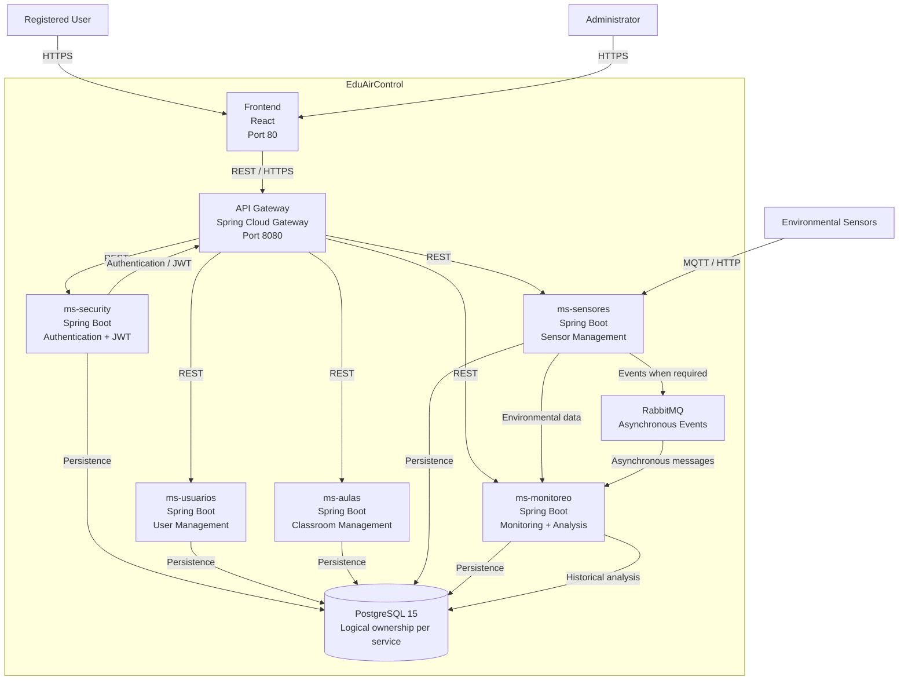

# System Architecture Overview

> **What to fill in here:** The architectural view is the technical snapshot of the system.
> It includes the C4 system and container diagram, service list, and architectural principles.
> This document is created after the main ADRs and guides the implementation.

---

## 1. Adopted architectural style

**Style:** Microservices + API Gateway + Event-Driven Communication

**Justification:** EduAirControl adopts a **microservices architecture** because the system is divided into independent business domains such as user and access management, educational classrooms, environmental sensors, and environmental monitoring and analysis.

The architecture allows each microservice to have a clearly defined responsibility and business boundary while maintaining controlled communication between services.

The main characteristics of the adopted architecture are:

- **Frontend React** as the web client.
- **Spring Cloud Gateway** as the API Gateway and single entry point for backend requests.
- **Spring Security + JWT** for authentication and authorization.
- Independent microservices for the main business domains:
  - `ms-security`
  - `ms-usuarios`
  - `ms-aulas`
  - `ms-sensores`
  - `ms-monitoreo`
- **PostgreSQL 15** as the persistence technology.
-The MVP uses one PostgreSQL instance with **logical ownership boundaries per service.** Services do not access another service's tables directly. 
- **REST/HTTP** for synchronous communication between the frontend, API Gateway and services.
- **MQTT/HTTP** for receiving environmental information from sensors.
- **RabbitMQ** can be used for asynchronous communication and events where decoupling is beneficial.
- **Docker** is used to standardize the execution environment of the project.

This architecture was selected because EduAirControl needs to receive environmental information, store it, expose it through APIs and perform historical analysis over daily, weekly, monthly and yearly periods.

The architecture also facilitates the independent evolution of each domain without requiring the entire system to be implemented as a single application.

**Reference ADR:** [`ADR-002, ADR-003, ADR-004, ADR-005, ADR-006, ADR-007`]

---

## 2. C4 Diagram — System Level (Context)

> Shows how the system fits in the world. External actors and external systems.

```
                         ┌──────────────────────────┐
                         │       ADMINISTRATOR      │
                         │                          │
                         │ Manage users, classrooms │
                         │ and sensors              │
                         └────────────┬─────────────┘
                                      │
                                      │ HTTPS
                                      ▼
┌────────────────────────────────────────────────────────────────────────────┐
│                              EDUAIRCONTROL                                  │
│                                                                            │
│   ┌────────────────────────────────────────────────────────────────────┐   │
│   │                         WEB APPLICATION                             │   │
│   │                              React                                 │   │
│   └───────────────────────────────┬────────────────────────────────────┘   │
│                                   │ HTTPS / REST                           │
│                                   ▼                                        │
│   ┌────────────────────────────────────────────────────────────────────┐   │
│   │                         API GATEWAY                                 │   │
│   │                     Spring Cloud Gateway                            │   │
│   └──────────────┬───────────────┬───────────────┬─────────────────────┘   │
│                  │               │               │                         │
│                  ▼               ▼               ▼                         │
│          ┌────────────┐  ┌────────────┐  ┌──────────────┐                 │
│          │ Security   │  │ Usuarios   │  │    Aulas     │                 │
│          │   Service  │  │  Service   │  │   Service    │                 │
│          └──────┬─────┘  └──────┬─────┘  └──────┬───────┘                 │
│                 │                │               │                         │
│                 └────────────────┼───────────────┘                         │
│                                  │                                         │
│                                  ▼                                         │
│                         ┌────────────────┐                                 │
│                         │   SENSORES     │                                 │
│                         │    SERVICE     │                                 │
│                         └───────┬────────┘                                 │
│                                 │                                          │
│                                 ▼                                          │
│                         ┌────────────────┐                                 │
│                         │   MONITOREO    │                                 │
│                         │    SERVICE     │                                 │
│                         └───────┬────────┘                                 │
│                                 │                                          │
│                                 ▼                                          │
│                         ┌────────────────┐                                 │
│                         │ PostgreSQL 15 │                                 │
│                         │  Domain-based  │                                 │
│                         └────────────────┘                                 │
│                                                                            │
└────────────────────────────────────────────────────────────────────────────┘
             ▲                                      ▲
             │                                      │
        HTTPS / REST                           MQTT / HTTP
             │                                      │
             │                                      │
     ┌───────┴────────┐                    ┌────────┴─────────┐
     │ Web Browser    │                    │ Environmental    │
     │                │                    │ Sensors / IoT    │
     └────────────────┘                    └──────────────────┘
```

### External actors and systems

| Actor/System | Interaction with EduAirControl |
|---|---|
| Registered user | Logs in and consults environmental information |
| Administrator | Manages users, classrooms and sensors |
| Environmental sensors | Send temperature, humidity, CO₂ and noise measurements |
| Web browser | Accesses the React frontend |
| MQTT/HTTP communication | Transports environmental measurements from sensors to the platform |

---

---

## 3. C4 Diagram — Container Level

> Shows the processes, databases, and main communication channels.

```
Replace this block with the project-specific diagram.

Recommended tools:
- PlantUML (see 08-uml/diagrams/source/)
- Mermaid (natively supported on GitHub)
- draw.io / Lucidchart
```

**Mermaid example:**



### Container responsibilities

| Container | Responsibility |
|---|---|
| React Frontend | Provides the web interface for authentication, management, monitoring and environmental analysis |
| API Gateway | Central entry point, routing and access control for backend services |
| `ms-security` | User registration, authentication, password management and JWT generation/validation |
| `ms-usuarios` | Management and consultation of registered users |
| `ms-aulas` | Management of educational classrooms/environments |
| `ms-sensores` | Registration, configuration and management of environmental sensors |
| `ms-monitoreo` | Reception, storage, consultation and analysis of environmental measurements |
| RabbitMQ | Optional asynchronous communication between services when events need to be decoupled |
| PostgreSQL 15 | Persistent storage organized logically according to project domains |

### Environmental data flow

```text
Environmental Sensor
        │
        │ MQTT / HTTP
        ▼
   ms-sensores
        │
        │ Environmental measurement
        ▼
   ms-monitoreo
        │
        ├──────────────► PostgreSQL 15
        │
        ▼
Historical Environmental Data
        │
        ▼
Daily / Weekly / Monthly / Yearly Analysis
        │
        ▼
     API Gateway
        │
        ▼
    React Frontend
        │
        ▼
      User
```

---

## 4. Service catalog

| # | Service | Responsibility | Port | DB | Communication type |
|---|---------|---------------|------|-----|-------------------|
| 1 | `api-gateway` | Central entry point, routing and request control | 8080 | No direct DB | HTTP/REST Proxy |
| 2 | `ms-security` | Registration, authentication, JWT and access control | 8081 | PostgreSQL - Security ownership boundary | REST |
| 3 | `ms-usuarios` | User management and user information | 8082 | PostgreSQL - Users ownership boundary | REST |
| 4 | `ms-aulas` | Educational classroom/environment management | 8083 | PostgreSQL - Classrooms ownership boundary | REST |
| 5 | `ms-sensores` | Environmental sensor registration and communication | 8084 | 	PostgreSQL - Sensors ownership boundary | REST + MQTT/HTTP |
| 6 | `ms-monitoreo` | Environmental data reception, storage, monitoring and analysis | 8085 | PostgreSQL - Monitoring ownership boundary | REST + MQTT/Events |
| 7 | `RabbitMQ` | Asynchronous messaging between services when required | 5672 | No | AMQP |
| 8 | `Frontend React` | User interface and visualization of environmental information | 80 | No | HTTP/HTTPS |

> Full detail per service in `09-microservices/service-catalog.md`

---

## 5. Architectural principles

These principles guide the project's technical decisions. Before making an important decision,
verify it is consistent with these principles.

### P1: API-First

Design the API contract (OpenAPI) before implementing the service.

Contracts are the source of truth for consumers and allow the frontend and backend teams to work with a common definition of requests, responses, errors and resources.

API contracts are maintained under:

`07-api/contracts/openapi/`

---

### P2: Domain-Oriented Data Separation

EduAirControl uses a PostgreSQL 15 instance organized by service ownership boundaries during the MVP.

Each microservice owns the data corresponding to its business responsibility and must not directly manipulate another domain's tables.
Communication between domains must occur through APIs or asynchronous events when applicable.

This principle was selected instead of requiring a separate physical database per service because the current project scope requires logical domain separation while keeping MVP operations manageable. Physical separation remains a future option

---

### P3: Fail Fast, Recover Gracefully

Requests must be validated as early as possible.

The system should:

- Validate required fields at the API boundary.
- Reject invalid authentication credentials immediately.
- Validate environmental measurements before persistence.
- Return standardized error responses.
- Prevent invalid data from propagating between services.
- Use timeout and resilience mechanisms for inter-service communication when they are implemented.

Circuit Breaker is considered a resilience mechanism for services with critical dependencies, but it is not considered fully implemented until validated in the project.

---

### P4: Observability by Design

The system should provide enough information to identify failures and understand the behavior of the services.

The architecture considers:

- Structured application logs.
- Correlation IDs for requests.
- Health checks.
- Service metrics.
- Monitoring of API response times.
- Monitoring of errors and service availability.

Advanced observability tools such as Prometheus, Grafana and OpenTelemetry are part of the planned architecture and should only be marked as implemented once they have been configured and validated.

---

### P5: Separation of Responsibilities

Each microservice must have a clearly defined business responsibility.

For example:

- `ms-security` handles authentication and access control.
- `ms-usuarios` handles user management.
- `ms-aulas` handles educational classrooms.
- `ms-sensores` handles environmental sensors.
- `ms-monitoreo` handles environmental measurements, monitoring and analysis.

A service should not absorb responsibilities belonging to another bounded context without an architectural justification.

---

### P6: Security by Design

Security is considered from the beginning of the architecture.

The system uses:

- Spring Security.
- JWT authentication.
- Role-based authorization.
- Password hashing.
- Validation of authenticated requests.
- Controlled access through the API Gateway.
- Protection of sensitive configuration through environment variables.
- HTTPS in environments where TLS is configured.

---

### P7: Contract and Traceability

Every important functional requirement should be traceable to:

```text
Requirement
    ↓
User Story
    ↓
API Contract
    ↓
Implementation
    ↓
Test
    ↓
Definition of Done
```

This principle helps maintain consistency between requirements, architecture, development and quality assurance.

---


## 6. Adopted architectural patterns

| Pattern | Adopted | Reference |
|---------|---------|-----------|
| Microservices | Yes | `05-architecture/decisions/` |
| API Gateway | Yes | `05-architecture/pattern-guide.md` |
| Domain-Oriented Data Separation | Yes | `02-domain/domain-map.md` |
| REST API | Yes | `07-api/contracts/openapi/` |
| JWT Authentication | Yes | `00-governance/security-policy.md` |
| Event-Driven Communication | Partial / Planned | RabbitMQ integration |
| CQRS | No | Not required for current scope |
| Event Sourcing | No | Not required for current scope |
| Circuit Breaker | Planned | `05-architecture/pattern-guide.md` |
| Saga | No | Not required for current business flows |
| Outbox Pattern | Planned / Review | To be evaluated if asynchronous events become critical |
| Hexagonal Architecture | Yes | `05-architecture/hexagonal-architecture.md` |
| Database per physical service | No | Single PostgreSQL infrastructure with domain separation |
| Containerization | Yes | Docker / Docker Compose |

---

## 7. Cross-cutting concerns

Transversal concerns that apply to ALL services:

| Concern | Adopted solution | Where it is configured |
|---|----------------|------------------------|
| Authentication / Authorization | Spring Security + JWT | `ms-security` and API Gateway |
| API Routing | Spring Cloud Gateway | `api-gateway` |
| Password Security | BCrypt/secure password hashing | `ms-security` |
| Logging | Application logs + Correlation ID | Each Spring Boot service |
| Tracing | Planned OpenTelemetry integration | Service middleware / infrastructure |
| Health Checks | Spring Boot Actuator health endpoints | Each backend service |
| Error format | Standardized API error response | `07-api/contracts/openapi/_shared.yaml` |
| Rate Limiting | Planned at API Gateway | Gateway configuration |
| CORS | API Gateway / backend configuration | Gateway configuration |
| Circuit Breaker | Planned with Resilience4j | `05-architecture/pattern-guide.md` |
| Database Migrations | Liquibase | Database migration configuration |
| Configuration | Environment variables / application configuration | Docker and Spring Boot configuration |
| Containerization | Docker | Dockerfiles / Docker Compose |
| Messaging | RabbitMQ when asynchronous communication is required | Messaging configuration |
| Sensor Communication | MQTT / HTTP | `ms-sensores` |
| API Documentation | OpenAPI | `07-api/contracts/openapi/` |

---

## 8. Registered architectural technical debt

| ID | Description | Impact | Priority | Target sprint |
|----|-------------|--------|---------|--------------|
| AT-001 | Complete and validate centralized API Gateway routing for all microservices | High | P1 | Sprint 2 |
| AT-002 | Complete JWT validation and role-based authorization across protected endpoints | High | P1 | Sprint 2 |
| AT-003 | Define and validate the final domain-to-table organization in PostgreSQL | Medium | P1 | Sprint 2 |
| AT-004 | Complete sensor communication integration using MQTT/HTTP | High | P1 | Sprint 3 |
| AT-005 | Define and validate asynchronous communication through RabbitMQ where necessary | Medium | P2 | Sprint 3 |
| AT-006 | Implement centralized correlation IDs and structured logging | Medium | P2 | Sprint 3 |
| AT-007 | Configure automated health checks and service monitoring | Medium | P2 | Sprint 4 |
| AT-008 | Evaluate and implement Circuit Breaker for critical inter-service communication | Medium | P2 | Sprint 4 |
| AT-009 | Validate performance requirements for critical API endpoints | Medium | P2 | Sprint 4 |
| AT-010 | Complete automated architecture and integration tests | Medium | P2 | Sprint 4 |

> See also: `15-project-control/technical-backlog.md`

---

## 9. Planned evolution

| Version | Architectural change | Motivation | Estimated date |
|---|---|---|---|
| v1.1 | Complete API Gateway integration | Centralize routing and backend access | Sprint 2 |
| v1.2 | Complete JWT/RBAC integration | Strengthen authentication and authorization | Sprint 2 |
| v1.3 | Integrate sensor communication | Receive real environmental measurements | Sprint 3 |
| v1.4 | Integrate RabbitMQ where required | Reduce coupling for asynchronous processes | Sprint 3-4 |
| v1.5 | Improve observability | Facilitate diagnosis and monitoring | Sprint 4 |
| v1.6 | Performance and resilience validation | Validate NFRs before final delivery | Sprint 4 |
| v2.0 | Evaluate independent database infrastructure per service | Increase service autonomy if project scale requires it | Future |
| v2.1 | Evaluate Kubernetes/container orchestration | Improve deployment scalability if required | Future |

---

## Key correlations

- Domain bounded contexts → `02-domain/domain-map.md`
- Domain language → `02-domain/`
- Functional requirements → `04-requirements/`
- Specific decision ADRs → `05-architecture/decisions/`
- Hexagonal architecture per service → `05-architecture/hexagonal-architecture.md`
- Applied patterns → `05-architecture/pattern-guide.md`
- API contracts → `07-api/contracts/openapi/`
- UML diagrams → `08-uml/`
- Per-service detail → `09-microservices/service-catalog.md`
- Docker and deployment → `10-devops/`
- Quality requirements → `11-quality/`
- Operations → `13-operations/`
- Technical debt → `15-project-control/technical-backlog.md`
- Security policy → `00-governance/security-policy.md`
