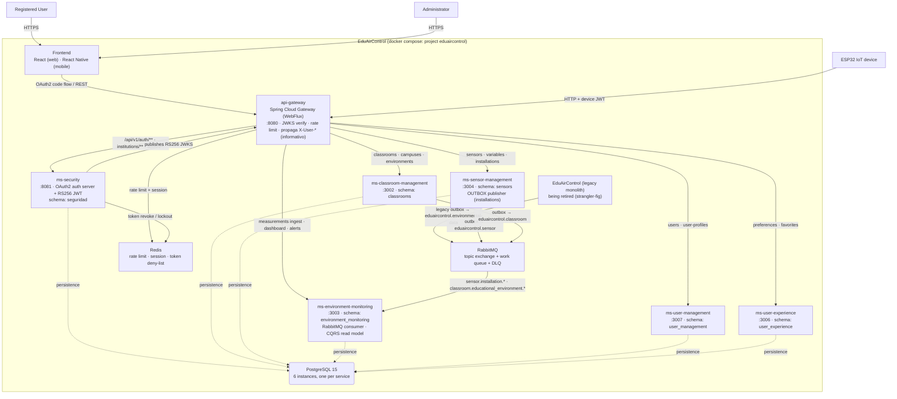

# System Architecture Overview

> The architectural view is the technical snapshot of the system as it is implemented today:
> the C4 system and container diagram, service catalog, architectural principles, adopted
> patterns and cross-cutting concerns. Where the code and an ADR disagree, this document
> describes what the code does and notes the drift.

---

## 1. Adopted architectural style

**Style:** Microservices + API Gateway + Event-Driven Communication (RabbitMQ)

EduAirControl is a **strangler-fig** migration: a legacy monolith (`EduAirControl/`) is being
extracted into independent microservices, one per bounded context. Each microservice has a
clearly defined responsibility and business boundary while keeping controlled communication
between services.

> **Legacy monolith:** the pre-microservices system and its full history live at
> [`Jhon-Cortez/EduAirControl`](https://github.com/Jhon-Cortez/EduAirControl). The migration
> extracts one bounded context at a time; existing data is moved across with temporary
> backfill services (`app.backfill.*` in `ms-environment-monitoring` and
> `ms-user-experience`) until the broker becomes the only path.

Main characteristics of the architecture as implemented:

- **Frontend**: React web application + React Native mobile app (`ea-control-frontend/`).
- **Spring Cloud Gateway** as the API Gateway and single entry point for backend requests,
  with JWT validation, Redis rate limiting and correlation IDs.
- **Spring Security + JWT** for authentication and authorization:
  - `ms-security` issues **RS256** JWTs and acts as an **OAuth2 / OIDC authorization server**.
  - Business services validate **RS256** JWTs against the ms-security JWKS and **ignore
    identity headers** — JWT-only mesh (ADR-018; ADR-006 always assumed services verify
    tokens themselves).
- Independent microservices for the main business domains:
  - `ms-security`
  - `ms-user-management`
  - `ms-classroom-management`
  - `ms-sensor-management`
  - `ms-environment-monitoring` (absorbs the deprecated `ms-alert`, ADR-015)
  - `ms-user-experience`
- **PostgreSQL** as the persistence technology. The `infra/` stack runs **one PostgreSQL
  instance per service** (6 instances), each with its own database and schema
  (`eduaircontrol_monitoring`, `eduaircontrol_user_experience`, …) — ADR-003. No service
  reads another service's tables.
- **REST/HTTP** for synchronous communication between the frontend, API Gateway and services.
- **RabbitMQ** for asynchronous event communication (transactional outbox → topic exchange →
  idempotent consumers). See `02-domain/domain-events.md` and ADR-007.
- **Redis** for the gateway rate limiter, session storage, token revocation deny-list and
  lockout counters.
- **Docker** standardizes the execution environment (`infra/docker-compose.yml`).
- Sensor / IoT ingest is **HTTP with a device JWT** (`roles: ["DEVICE"]`, validated against
  the ms-security JWKS), not MQTT; the `X-API-Key` path belonged to the legacy monolith
  (ADR-004, ADR-018).

**Reference ADRs:** ADR-002, ADR-003, ADR-004, ADR-005, ADR-006, ADR-007, ADR-016, ADR-017.

---

## 2. C4 Diagram — System Level (Context)

Shows how the system fits in the world: external actors and systems.

```
                         ┌──────────────────────────┐
                         │       ADMINISTRATOR      │
                         │                          │
                         │ Manage users, classrooms │
                         │ and sensors              │
                         └────────────┬─────────────┘
                                      │
                                      │ HTTPS
                                      ▼
┌────────────────────────────────────────────────────────────────────────────┐
│                              EDUAIRCONTROL                                  │
│                                                                            │
│   ┌────────────────────────────────────────────────────────────────────┐   │
│   │                         WEB + MOBILE CLIENTS                        │   │
│   │                      React (web) / React Native                     │   │
│   └───────────────────────────────┬────────────────────────────────────┘   │
│                                   │ HTTPS / REST                           │
│                                   ▼                                        │
│   ┌────────────────────────────────────────────────────────────────────┐   │
│   │                         API GATEWAY                                 │   │
│   │                     Spring Cloud Gateway                            │   │
│   │        JWT verify (JWKS) · rate limit (Redis) · correlation ID      │   │
│   └──────────┬──────────────┬──────────────┬──────────────┬─────────────┘   │
│              │              │              │              │                 │
│              ▼              ▼              ▼              ▼                 │
│        ┌──────────┐   ┌──────────┐   ┌──────────┐   ┌──────────┐            │
│        │ ms-      │   │ ms-user- │   │ ms-      │   │ ms-      │            │
│        │ security │   │ mgmt +   │   │ classroom│   │ sensor   │            │
│        │ :8081    │   │ ux :3007 │   │ :3002    │   │ :3004    │            │
│        └────┬─────┘   │ :3006    │   └─────┬────┘   └────┬─────┘            │
│             │         └────┬─────┘        │             │                  │
│             │              │              │             │  events (outbox)│
│             │              │              │             ▼                  │
│             │              │              │     ┌──────────────┐           │
│             │              │              │     │  RabbitMQ    │           │
│             │              │              │     └──────┬───────┘           │
│             │              │              │            │ consume          │
│             │              │              │            ▼                  │
│             │              │              │     ┌──────────────────┐       │
│             │              │              │     │ ms-environment-  │       │
│             │              │              │     │ monitoring :3003 │       │
│             │              │              │     └────────┬─────────┘       │
│             │              │              │              │                 │
│             └──────────────┼──────────────┼──────────────┼────────────────┘
│                            │              │              │
│                            └───────┬──────┘              │
│                                   ▼                       │
│                    6 × PostgreSQL  (one per service)      │
│                                     Redis  ·  RabbitMQ    │
└────────────────────────────────────────────────────────────────────────────┘
             ▲                                        ▲
             │                                        │
        HTTPS / REST                            HTTP + device JWT
             │                                        │
             │                                        │
     ┌───────┴────────┐                       ┌───────┴────────┐
     │ Web / Mobile   │                       │ ESP32 sensors /│
     │ users          │                       │ IoT devices    │
     └────────────────┘                       └────────────────┘
```

### External actors and systems

| Actor/System | Interaction with EduAirControl |
|---|---|
| Registered user | Logs in (OAuth2 authorization code flow) and consults environmental information |
| Administrator | Manages users, classrooms and sensors |
| ESP32 / IoT devices | Send temperature, humidity, CO₂ and noise measurements via HTTP with a device JWT (`roles: ["DEVICE"]`) |
| Web browser / mobile app | Access the React / React Native frontend |
| RabbitMQ / Redis / PostgreSQL | Infrastructure droplets: async events, rate-limit/revocation, persistence |

---

## 3. C4 Diagram — Container Level

Shows the processes, databases, and main communication channels as deployed by
`infra/docker-compose.yml`.



### Container responsibilities

| Container | Responsibility |
|---|---|
| React / React Native frontends | Provide the web and mobile interfaces for authentication, management, monitoring and environmental analysis |
| `api-gateway` | Central entry point: path-based routing, JWT validation against ms-security's JWKS, Redis rate limiting, correlation IDs, gateway forwarding of identity headers |
| `ms-security` | Registration, authentication, password management, OAuth2/OIDC authorization server, RS256 JWT issuing, refresh-token rotation, token revocation (Redis), tenants (institutions), SUPER_ADMIN bootstrap seed |
| `ms-user-management` | Management and consultation of user profile data |
| `ms-classroom-management` | Management of educational classrooms/campuses/environment types |
| `ms-sensor-management` | Registration, configuration and management of environmental sensors; publishes `SensorInstalled`/`SensorRemoved` events through a transactional outbox (measurement events are produced by the legacy monolith) |
| `ms-environment-monitoring` | Reception, storage, consultation and analysis of environmental measurements, dashboard read models, and threshold alerts; consumes RabbitMQ events idempotently; maintains a local projection of installations |
| `ms-user-experience` | User preferences and favorites |
| RabbitMQ | Asynchronous, at-least-once event communication between services: topic exchanges `eduaircontrol.environmental-data` (measurements, produced by the monolith) and `eduaircontrol.sensor` (installations, produced by ms-sensor-management), durable work queue and DLQ on the consumer side |
| Redis | Gateway rate limiting, session storage, token revocation deny-list, lockout counters |
| PostgreSQL | Persistent storage; one instance per service in the `infra` stack |

### Environmental data flow

```text
ESP32 IoT device (device JWT, roles: DEVICE)
        │
        │ HTTP POST /api/v1/measurements (gateway → ms-environment-monitoring)
        │ ms-sensor-management outbox (eduaircontrol.sensor → installations)
        │ ms-classroom-management outbox (eduaircontrol.classroom → environments)
        ▼
 RabbitMQ topic exchanges
        │ bindings: sensor.installation.*  /  classroom.educational_environment.*
        ▼
 ms-environment-monitoring
   MeasurementController (ingest) · SensorInstallationListener · ClassroomEnvironmentListener
        │
        │ inbox claim (idempotency, ON CONFLICT DO NOTHING)
        ▼
 projection → environment_measurement / installation_projection / educational_environment
        │
        ├─ threshold evaluation ──► alerts (raiseIfAbsent)
        ▼
 Dashboard read model (summary / series)
        │
        ▼
 API Gateway ──► React Frontend ──► User
```

---

## 4. Service catalog

| # | Service | Responsibility | Port | DB | Communication |
|---|---------|---------------|------|-----|----------------|
| 1 | `api-gateway` | Central entry point, routing, JWT verify, rate limit | 8080 | Redis (rate/session) | HTTP proxy |
| 2 | `ms-security` | Registration, authentication, OAuth2, JWT (RS256), tenants | 8081 | PostgreSQL `seguridad` | REST |
| 3 | `ms-user-management` | User profile management | 3007 | PostgreSQL `user_management` | REST |
| 4 | `ms-classroom-management` | Classroom / campus / environment type management | 3002 | PostgreSQL `classrooms` | REST |
| 5 | `ms-sensor-management` | Sensor / variable / installation management | 3004 | PostgreSQL `sensors` | REST + RabbitMQ (outbox publish) |
| 6 | `ms-environment-monitoring` | Measurement reception, dashboard, analysis, alerts | 3003 | PostgreSQL `environment_monitoring` | REST + RabbitMQ (consume) |
| 7 | `ms-user-experience` | Preferences, favorites | 3006 | PostgreSQL `user_experience` | REST |
| 8 | PostgreSQL | One instance per service (see note below) | 5433–5439 | — | JDBC |
| 9 | RabbitMQ | Asynchronous messaging (topic exchange + DLQ) | 5672 / 15672 | — | AMQP |
| 10 | Redis | Rate limit, sessions, token revocation | 6379 | — | RESP |

> **Database note:** ADR-003 describes a shared PostgreSQL instance with one schema per
> service. The `infra/docker-compose.yml` stack runs **six separate PostgreSQL 15 containers**
> (`postgres-security` :5437, `postgres-classroom` :5433, `postgres-sensor` :5434,
> `postgres-monitoring` :5435, `postgres-user-management` :5438,
> `postgres-user-experience` :5439), each with its own database
> (`eduaircontrol_monitoring`, `eduaircontrol_user_experience`, …). This is a documented
> drift between ADR-003 and the current deployment.

> Full detail per service in `09-microservices/service-catalog.md`

---

## 5. Architectural principles

These principles guide the project's technical decisions.

### P1: API-First

Design the API contract (OpenAPI) before implementing the service.

Contracts are the source of truth for consumers and allow the frontend and backend teams to
work with a common definition of requests, responses, errors and resources.

API contracts are maintained under `07-api/contracts/openapi/`.

---

### P2: Domain-Oriented Data Separation

Each microservice owns the data corresponding to its business responsibility and must not
directly manipulate another domain's tables.

Communication between domains must occur through APIs or asynchronous events when applicable.

The `infra` stack provisions one physical PostgreSQL instance per service, each with its own
database and schema (ADR-003). In all cases ownership is logical and services do not read each
other's tables.

---

### P3: Fail Fast, Recover Gracefully

Requests are validated as early as possible:

- Required fields are validated at the API boundary (Bean Validation + domain validation).
- Invalid authentication credentials are rejected immediately.
- Environmental measurements are validated before persistence.
- Errors are returned in a unified `{ status, message }` shape by a global exception handler
  in each service.
- Transient failures on the consumer side self-heal via retries (1s → 2s → 4s → 8s); failed
  events go to a dead-letter queue instead of being lost.

Circuit breaker middleware (ADR-013) is **documented but not yet implemented** in the codebase.

---

### P4: Observability by Design

As implemented today:

- Health checks (`/health`, public) on every service.
- Correlation IDs propagated by the gateway (`CorrelationIdFilter`).
- Structured application logs (SLF4J).

Prometheus, Grafana and OpenTelemetry exist as an **observability overlay compose file**
(`infra/docker-compose.observability.yml`) but are **not yet wired** to the running services.

---

### P5: Separation of Responsibilities

Each microservice has a clearly defined business responsibility:

- `ms-security` → authentication and access control (OAuth2, JWT, tenants).
- `ms-user-management` → user information.
- `ms-user-experience` → user preferences and experience.
- `ms-classroom-management` → educational classrooms/campuses.
- `ms-sensor-management` → environmental sensors, variables and installations.
- `ms-environment-monitoring` → measurements, dashboard, analysis and alerts (the deprecated
  `ms-alert` was folded in, ADR-015).

---

### P6: Security by Design

- Spring Security + JWT.
- OAuth2 / OIDC authorization server (`ms-security`, ADR-017).
- Role-based authorization (`ADMIN` for write operations).
- Password hashing, refresh-token rotation, account lockout, token revocation via Redis.
- Controlled access through the API Gateway.
- Sensitive configuration via environment variables.
- Do not log secrets.

---

### P7: Contract and Traceability

Every important functional requirement is traceable to:

```text
Requirement → User Story → API Contract → Implementation → Test → Definition of Done
```

This principle helps maintain consistency between requirements, architecture, development
and quality assurance.

---

## 6. Adopted architectural patterns

| Pattern | Adopted | Reference |
|---------|---------|-----------|
| Microservices | Yes | `05-architecture/pattern-guide.md` |
| API Gateway | Yes | `05-architecture/pattern-guide.md` |
| Strangler Fig (monolith → microservices) | In progress | Legacy `EduAirControl/` alongside the `ms-*` services |
| Domain-Oriented Data Separation | Yes | `02-domain/domain-map.md` |
| REST API (versioned, `/api/v1`) | Yes | `07-api/contracts/openapi/` |
| OAuth2 / OIDC Authorization Server + BFF | Yes (`ms-security`, gateway) | ADR-017 |
| Transactional Outbox | Yes (`ms-sensor-management`, monolith) | ADR-007 |
| Event-Driven Communication (RabbitMQ) | Yes | ADR-004, ADR-007 |
| CQRS (read model / projections) | Yes (in `ms-environment-monitoring`) | `05-architecture/pattern-guide.md` |
| Hexagonal Architecture (ports & adapters) | Yes (all `ms-*`) | ADR-009, `05-architecture/hexagonal-architecture.md` |
| Saga / Event Sourcing | No | Not used in the current business flows |
| Circuit Breaker | No (documented, ADR-013) | `05-architecture/pattern-guide.md` |
| Database per physical service | Yes (in `infra` stack) | `infra/docker-compose.yml` |
| Containerization | Yes | Docker / Docker Compose |

---

## 7. Cross-cutting concerns

Concerns that apply to ALL services:

| Concern | Adopted solution | Where it is configured |
|---|----------------|------------------------|
| Authentication / Authorization | Spring Security + JWT (RS256 issued, HS256 interim) | `ms-security`, API Gateway, per service |
| API Routing | Spring Cloud Gateway (path predicates) | `api-gateway/src/main/resources/application.yml` |
| OAuth2 login (BFF) | Spring Security OAuth2 client + Redis sessions | `api-gateway` |
| Password Security | BCrypt, account lockout | `ms-security` |
| Token revocation | Redis deny-list (`blacklist:{jti}`, TTL = remaining lifetime) | `ms-security` → Redis |
| Rate Limiting | Gateway filter, Redis-backed, 100 req/60s | `api-gateway` `RateLimitFilter` |
| Correlation IDs | Gateway `CorrelationIdFilter` | `api-gateway` |
| Logging | SLF4J (`@Slf4j`) | Each Spring Boot service |
| Health Checks | Spring Boot actuator `/health` (public) | Each backend service |
| Error format | Unified `{ status, message }` via `@RestControllerAdvice` | Each service `GlobalExceptionHandler` |
| CORS | Gateway default filter | `api-gateway` |
| Database Migrations | Liquibase (`ddl-auto=none` or `validate`) | Per service |
| Configuration | Environment variables over Spring properties | Docker / docker-compose |
| Containerization | Docker | `infra/docker-compose.yml` |
| Messaging | RabbitMQ (outbox publish / inbox consume) | `ms-sensor-management`, `ms-environment-monitoring` |
| Sensor Communication | HTTP ingest with a device JWT (`roles: ["DEVICE"]`) | `ms-environment-monitoring` `MeasurementController` |
| Environmental Variables | CO₂, Humidity, Noise, Temperature (ADR-014) | `06-data/domain/ms-environment-monitoring.md` |
| API Documentation | springdoc OpenAPI + Swagger UI | Per service (`/swagger-ui.html`) |
| Tracing | OpenTelemetry **planned** (compose overlay exists) | `infra/docker-compose.observability.yml` |

---

## 8. Observed deviations between code and documented decisions

| # | Deviation | Current state in the code |
|---|-----------|---------------------------|
| D-001 | `ms-environment-monitoring` vs `ms-sensor-management` | Per AGENTS.md it was a byte-for-byte copy; the two Maven projects have since diverged (artifactId, port 3003 vs 3004, schema, RabbitMQ consumer, Testcontainers tests). |
| D-002 | Database strategy | ADR-003 specifies a shared PostgreSQL with one schema per service; the `infra` stack runs 6 separate PostgreSQL containers, each with its own database (`eduaircontrol_monitoring`, `eduaircontrol_user_experience`, …). |
| D-003 | JWT scheme | `ms-security` issues RS256 (JWKS at `/api/v1/auth/jwks`); business services are **JWT-only** since ADR-018 (2026-10-17) — no shared secret, no trust in `X-User-*` headers. |
| D-004 | JVM version | `docs-ea-control/_stacks/java-spring.md` states JDK 21; all services compile with **Java 17**. |
| D-005 | Documentation accuracy | ~~`ms-security/README.md` is titled "ms-sensor-management"~~ — fixed: the README now describes ms-security correctly. |
| D-006 | Tests | 4 services run tests on H2 (Liquibase disabled); `ms-environment-monitoring`, `ms-user-experience` and the monolith use Testcontainers (PostgreSQL/RabbitMQ, require Docker). |

---

## 9. Deployment (current state)

- **Local development stack**: `infra/docker-compose.yml` (project `eduaircontrol`): the 7
  application containers + 6 PostgreSQL 15, RabbitMQ 3.13 (management), Redis 7, plus named
  volumes. Smoke coverage: `infra/scripts/smoke.sh`.
- **Observability overlay**: `infra/docker-compose.observability.yml` — Prometheus, Grafana,
  OpenTelemetry collector (ADR-012). Present but not wired to services.
- **Canonical ports** (shared with the frontend):
  gateway `8080`, ms-security `8081`, classroom `3002`, environment-monitoring `3003`,
  sensor `3004`, user-experience `3006`, user-management `3007`.

---

## Key correlations

- Domain bounded contexts → `02-domain/domain-map.md`
- Domain language → `02-domain/`
- Functional requirements → `04-requirements/`
- Specific decision ADRs → `05-architecture/decisions/`
- Hexagonal architecture per service → `05-architecture/hexagonal-architecture.md`
- Applied patterns → `05-architecture/pattern-guide.md`
- API contracts → `07-api/contracts/openapi/`
- UML diagrams → `08-uml/`
- Per-service detail → `09-microservices/service-catalog.md`
- Docker and deployment → `10-devops/`
- Quality requirements → `11-quality/`
- Operations → `13-operations/`
- Security policy → `00-governance/security-policy.md`
