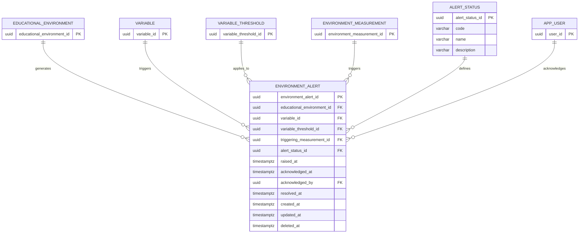

# Data Model — Alert

> **Purpose:** Define the data model used to manage alerts generated when an environmental measurement exceeds a configured threshold in an educational environment.
>
> EduAirControl currently uses a **monolithic database architecture**. Although the application is designed to evolve toward a microservices-oriented architecture, the current data model uses a shared relational database and can therefore use physical foreign key relationships between related tables.
>
> Schema changes are managed through versioned migrations and should not be applied manually to production databases.

---

## Data modeling principles

### 1. Monolithic database

EduAirControl currently uses a centralized PostgreSQL database.

Related domains can establish physical foreign key relationships because the entities are stored within the same database.

```text
✓ environment_alert → educational_environment
✓ environment_alert → variable
✓ environment_alert → variable_threshold
✓ environment_alert → environment_measurement
✓ environment_alert → app_user

✗ No duplicated data when an existing entity can be referenced
✗ No unnecessary cross-database references
```

The current monolithic model does not prevent the application from evolving toward a microservices-oriented architecture in the future.

---

### 2. Identifiers

Entities use UUID identifiers to provide unique and consistent identifiers throughout the system.

```sql
id UUID PRIMARY KEY DEFAULT gen_random_uuid()
```

Foreign keys use the same UUID type as the referenced entity.

---

### 3. Audit fields

Persistent tables include standard audit information:

```sql
created_at  TIMESTAMPTZ NOT NULL DEFAULT NOW(),
updated_at  TIMESTAMPTZ NOT NULL DEFAULT NOW(),
deleted_at  TIMESTAMPTZ
```

`deleted_at` is `NULL` while the record is active and contains a timestamp when the record is soft-deleted.

---

### 4. Naming conventions

```sql
-- Tables:      snake_case, descriptive
--              environment_alert, alert_status

-- Columns:     snake_case, descriptive
--              variable_threshold_id, raised_at

-- Foreign keys:
--              [referenced_table]_id

-- Indexes:
--              idx_[table]_[column]

-- Timestamps:
--              TIMESTAMPTZ
```

---

## Domain: Alert

**DB Engine:** PostgreSQL 15

**Engine justification:**

* PostgreSQL provides ACID transactions and referential integrity for alert management.
* Foreign keys ensure that alerts reference valid environments, variables, thresholds, measurements, and users.
* `TIMESTAMPTZ` is used to correctly represent events occurring at specific points in time.
* Check constraints can be used to guarantee valid alert lifecycle states.
* Indexes support frequent queries such as active alerts, alerts by environment, and alerts ordered by creation time.

---

## Table: alert_status

**Purpose:** Defines the possible lifecycle states of an environmental alert.

```sql
CREATE TABLE alert_status (

  alert_status_id UUID PRIMARY KEY DEFAULT gen_random_uuid(),

  -- Business fields
  code            VARCHAR(30)  NOT NULL UNIQUE,
  name            VARCHAR(80)  NOT NULL,
  description     VARCHAR(255),

  -- Audit
  created_at      TIMESTAMPTZ NOT NULL DEFAULT NOW(),
  updated_at      TIMESTAMPTZ NOT NULL DEFAULT NOW(),
  deleted_at      TIMESTAMPTZ
);

-- Indexes
CREATE INDEX idx_alert_status_code
  ON alert_status (code);

CREATE INDEX idx_alert_status_deleted
  ON alert_status (deleted_at)
  WHERE deleted_at IS NULL;
```

### Data dictionary

| Column            | Type         | Description                               | Example                    |
| ----------------- | ------------ | ----------------------------------------- | -------------------------- |
| `alert_status_id` | UUID         | Unique identifier of the alert status     | `550e8400-e29b-...`        |
| `code`            | VARCHAR(30)  | Internal code used to identify the status | `OPEN`                     |
| `name`            | VARCHAR(80)  | Human-readable status name                | `Open`                     |
| `description`     | VARCHAR(255) | Description of the status                 | `Alert requires attention` |
| `created_at`      | TIMESTAMPTZ  | When the status was created               | `2026-09-09T15:30:00Z`     |
| `updated_at`      | TIMESTAMPTZ  | When the status was last updated          | `2026-09-09T15:30:00Z`     |
| `deleted_at`      | TIMESTAMPTZ  | NULL = active; value = soft deleted       | `NULL`                     |

### Initial status values

The Alert domain uses the following lifecycle states:

```text
OPEN
    ↓
ACKNOWLEDGED
    ↓
RESOLVED
```

* **OPEN:** The alert has been generated and requires attention.
* **ACKNOWLEDGED:** A user has reviewed or taken responsibility for the alert.
* **RESOLVED:** The condition that generated the alert has been resolved.

### Modeling decisions

1. `code` is unique to prevent duplicate status definitions.
2. Statuses are stored separately from `environment_alert` to avoid repeating literal status values across records.
3. Status records use soft deletion to preserve historical references and avoid physically removing statuses that may have been used by existing alerts.

---

## Table: environment_alert

**Purpose:** Records an alert generated when an environmental measurement exceeds a configured threshold for an educational environment.

```sql
CREATE TABLE environment_alert (

  environment_alert_id       UUID PRIMARY KEY DEFAULT gen_random_uuid(),

  -- Relationships
  educational_environment_id UUID NOT NULL
    REFERENCES educational_environment(educational_environment_id)
    ON DELETE RESTRICT,

  variable_id                UUID NOT NULL
    REFERENCES variable(variable_id)
    ON DELETE RESTRICT,

  variable_threshold_id      UUID NOT NULL
    REFERENCES variable_threshold(variable_threshold_id)
    ON DELETE RESTRICT,

  triggering_measurement_id  UUID NOT NULL
    REFERENCES environment_measurement(environment_measurement_id)
    ON DELETE RESTRICT,

  alert_status_id            UUID NOT NULL
    REFERENCES alert_status(alert_status_id)
    ON DELETE RESTRICT,

  -- Alert lifecycle
  raised_at                  TIMESTAMPTZ NOT NULL DEFAULT NOW(),
  acknowledged_at            TIMESTAMPTZ,
  acknowledged_by            UUID
    REFERENCES app_user(user_id)
    ON DELETE RESTRICT,
  resolved_at                TIMESTAMPTZ,

  -- Audit
  created_at                 TIMESTAMPTZ NOT NULL DEFAULT NOW(),
  updated_at                 TIMESTAMPTZ NOT NULL DEFAULT NOW(),
  deleted_at                 TIMESTAMPTZ
);

-- Indexes
CREATE INDEX idx_environment_alert_environment
  ON environment_alert (educational_environment_id);

CREATE INDEX idx_environment_alert_variable
  ON environment_alert (variable_id);

CREATE INDEX idx_environment_alert_threshold
  ON environment_alert (variable_threshold_id);

CREATE INDEX idx_environment_alert_measurement
  ON environment_alert (triggering_measurement_id);

CREATE INDEX idx_environment_alert_status
  ON environment_alert (alert_status_id);

CREATE INDEX idx_environment_alert_raised_at
  ON environment_alert (raised_at);

CREATE INDEX idx_environment_alert_deleted
  ON environment_alert (deleted_at)
  WHERE deleted_at IS NULL;
```

---

## Data dictionary

| Column                       | Type        | Description                                               | Example                |
| ---------------------------- | ----------- | --------------------------------------------------------- | ---------------------- |
| `environment_alert_id`       | UUID        | Unique identifier of the alert                            | `550e8400-e29b-...`    |
| `educational_environment_id` | UUID        | Educational environment where the alert occurred          | `7b9e...`              |
| `variable_id`                | UUID        | Environmental variable associated with the alert          | `3f2a...`              |
| `variable_threshold_id`      | UUID        | Threshold that was evaluated when the alert was generated | `91cd...`              |
| `triggering_measurement_id`  | UUID        | Measurement that caused the alert to be generated         | `4ac8...`              |
| `alert_status_id`            | UUID        | Current lifecycle status of the alert                     | `OPEN`                 |
| `raised_at`                  | TIMESTAMPTZ | Date and time when the alert was generated                | `2026-09-09T15:30:00Z` |
| `acknowledged_at`            | TIMESTAMPTZ | Date and time when the alert was acknowledged             | `2026-09-09T15:35:00Z` |
| `acknowledged_by`            | UUID        | User who acknowledged the alert                           | `8d31...`              |
| `resolved_at`                | TIMESTAMPTZ | Date and time when the alert was resolved                 | `2026-09-09T15:50:00Z` |
| `created_at`                 | TIMESTAMPTZ | When the alert record was created                         | `2026-09-09T15:30:00Z` |
| `updated_at`                 | TIMESTAMPTZ | When the alert record was last updated                    | `2026-09-09T15:45:00Z` |
| `deleted_at`                 | TIMESTAMPTZ | NULL = active; value = soft deleted                       | `NULL`                 |

---

## Alert generation flow

An alert is generated from an environmental measurement and the applicable threshold.

```text
environment_measurement
          │
          │ Measurement evaluated
          ▼
variable_threshold
          │
          │ Threshold exceeded
          ▼
environment_alert
          │
          ├── educational_environment
          ├── variable
          ├── variable_threshold
          ├── triggering_measurement
          └── alert_status
```

For example:

```text
Environment:
Classroom A

Variable:
CO2

Threshold:
Maximum = 1000 ppm

Measurement:
CO2 measurement exceeds the configured threshold

Result:
environment_alert created with status OPEN
```

The measurement itself remains stored in `environment_measurement`. The alert only references the measurement that caused the alert through `triggering_measurement_id`.

---

## Alert acknowledgement

When a user acknowledges an alert:

```text
alert_status
    OPEN
      │
      │ User acknowledges
      ▼
 ACKNOWLEDGED
```

The system records:

```text
acknowledged_at
acknowledged_by
```

This provides traceability of who acknowledged the alert and when.

---

## Alert resolution

When the condition associated with the alert is resolved:

```text
ACKNOWLEDGED
      │
      │ Condition resolved
      ▼
  RESOLVED
```

The system records:

```text
resolved_at
```

The alert remains stored for historical and auditing purposes.

---

## Modeling decisions

1. `environment_alert_id` uses UUID to maintain consistency with the identifiers used throughout EduAirControl.

2. `educational_environment_id` is mandatory because every environmental alert must be associated with the environment where the abnormal condition occurred.

3. `variable_id` is mandatory because the alert must identify which environmental variable generated it, such as temperature, humidity, CO₂, or noise.

4. `variable_threshold_id` is mandatory because the alert must retain the threshold configuration that was used when the alert was generated.

5. `triggering_measurement_id` is mandatory because every threshold-based alert must be traceable to the measurement that caused it.

6. `alert_status_id` represents the lifecycle of the alert instead of storing the status as unrestricted text.

7. `acknowledged_at` and `acknowledged_by` are nullable because an alert does not necessarily have an acknowledgement immediately after being generated.

8. `resolved_at` is nullable because an alert can remain unresolved after being generated or acknowledged.

9. `ON DELETE RESTRICT` is used for the relationships with environments, variables, thresholds, measurements, and users to prevent deleting records that are referenced by historical alerts.

10. `triggering_value` is intentionally not stored in `environment_alert`. The measurement that generated the alert is already referenced through `triggering_measurement_id`, avoiding unnecessary duplication of measurement data.

11. Soft deletion is used to preserve the historical record of alerts and maintain auditability.

---

## Relationship diagram



---

## Migration strategy

**Tool:** Liquibase

**File naming convention:**

```text
db.changelog/
├── db.changelog-master.yaml
└── changes/
    ├── 001-create-alert-status.yaml
    ├── 002-create-environment-alert.yaml
    └── 003-add-alert-indexes.yaml
```

### Migration rules

```text
✓ Migrations are always forward-only.

✓ One migration should represent one logical database change.

✓ Migrations must be versioned and tracked by Liquibase.

✓ A migration that has already been executed must not be modified.

✓ Changes to the schema must be performed through Liquibase.

✗ Do not manually modify production tables.

✗ Do not modify an already executed migration.
```

---

## Correlations

* Alert domain entities and business rules → `02-domain/entities-and-rules.md`
* Alert architecture and domain boundaries → `05-architecture/`
* Alert API contracts → `07-api/contracts/openapi/`
* Microservice evolution and service boundaries → `09-microservices/services/`
* Database migrations → `database/changelog/`
* Environmental measurements → Measurement domain
* Threshold configuration → Alert domain
