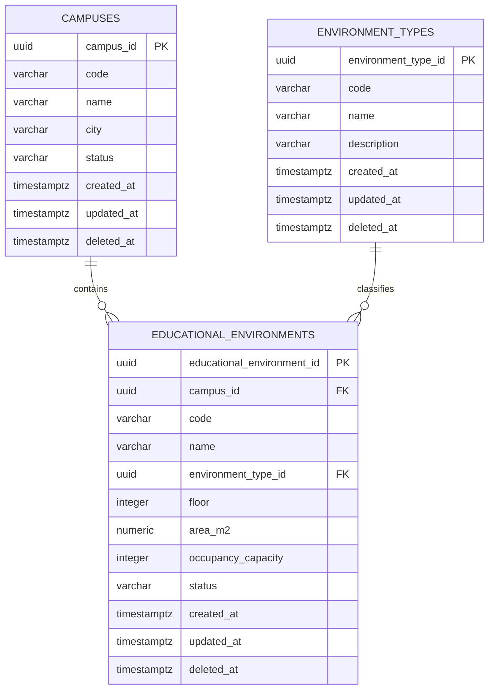

# Classroom Management — Data Model

## 1. Overview

The Classroom Management domain manages the physical and educational spaces monitored by EduAirControl.

The model distinguishes between a **campus** and an **educational environment**.

An educational environment represents the actual physical space monitored by the platform and does not have to be a traditional classroom. It may represent a classroom, laboratory, computer lab, auditorium, library, workshop, or another educational space.

This domain is responsible for:

* Campuses
* Educational Environments
* Environment Types

EduAirControl currently uses a **monolithic application architecture with a centralized relational database**. Therefore, the tables defined in this domain are part of the same PostgreSQL database and may establish physical foreign key relationships with tables belonging to other domains.

The database uses:

* PostgreSQL 15
* UUID identifiers
* English `snake_case` naming
* `TIMESTAMPTZ` for timestamps
* Soft deletion through `deleted_at`
* Liquibase for versioned database migrations

---

## 2. Database Design

```dbml
Project ClassroomManagement {
  database_type: 'PostgreSQL'
  Note: 'Management of campuses and educational environments monitored by EduAirControl'
}

Table campuses {
  campus_id uuid [pk, default: `gen_random_uuid()`]
  code varchar(30) [not null, unique]
  name varchar(150) [not null]
  city varchar(100)
  status varchar(30) [not null, default: 'ACTIVE']
  created_at timestamptz [not null, default: `now()`]
  updated_at timestamptz [not null, default: `now()`]
  deleted_at timestamptz
}

Table environment_types {
  environment_type_id uuid [pk, default: `gen_random_uuid()`]
  code varchar(30) [not null, unique]
  name varchar(80) [not null, unique]
  description varchar(255)
  created_at timestamptz [not null, default: `now()`]
  updated_at timestamptz [not null, default: `now()`]
  deleted_at timestamptz
}

Table educational_environments {
  educational_environment_id uuid [pk, default: `gen_random_uuid()`]
  campus_id uuid [not null]
  code varchar(30) [not null]
  name varchar(120) [not null]
  environment_type_id uuid [not null]
  floor integer
  area_m2 numeric(8,2)
  occupancy_capacity integer
  status varchar(30) [not null, default: 'ACTIVE']
  created_at timestamptz [not null, default: `now()`]
  updated_at timestamptz [not null, default: `now()`]
  deleted_at timestamptz

  indexes {
    (campus_id, code) [unique]
    campus_id
    environment_type_id
    status
  }
}

Ref: educational_environments.campus_id > campuses.campus_id
Ref: educational_environments.environment_type_id > environment_types.environment_type_id
```

---

## 3. Relationships

```text
Campus 1 ───────── N Educational Environment

Environment Type 1 ───────── N Educational Environment
```

An educational environment:

* Belongs to exactly one campus.
* Has exactly one environment type.
* Can be associated with many environmental measurements.
* Can be associated with many alerts.
* Can be used as the subject of environmental analyses.

Because EduAirControl currently uses a centralized database, these relationships are represented using physical foreign keys.

---

## 4. Design Decisions

### Campus

A campus represents a physical institutional site where one or more educational environments are located.

Examples:

```text
Main Campus
Technical Campus
North Campus
```

The `code` is unique and can be used as a stable business identifier.

### Educational Environment

`educational_environments` represents the physical educational spaces monitored by EduAirControl.

The term is intentionally broader than `classroom` because the platform can monitor different types of educational spaces.

Examples:

```text
Room A-101
Chemistry Laboratory
Computer Lab 02
Auditorium
Library
Electronics Workshop
```

The `(campus_id, code)` combination is unique so different campuses can use the same local environment code.

### Environment Type

`environment_types` avoids repeated free-text values and provides a controlled classification for educational environments.

Examples:

```text
CLASSROOM
LABORATORY
COMPUTER_LAB
AUDITORIUM
LIBRARY
WORKSHOP
OTHER
```

The `code` and `name` fields are unique.

---

## 5. Recommended Constraints

The following constraints should be enforced at database level whenever possible.

### Campus

* `campuses.code` must be unique.
* `campuses.name` must not be null.

### Environment Type

* `environment_types.code` must be unique.
* `environment_types.name` must be unique.

### Educational Environment

* `campus_id` must reference an existing campus.
* `environment_type_id` must reference an existing environment type.
* `(campus_id, code)` must be unique.
* `floor` must be null or greater than or equal to `0`.
* `area_m2` must be null or greater than `0`.
* `occupancy_capacity` must be null or greater than `0`.

Recommended PostgreSQL constraints:

```sql
CHECK (floor IS NULL OR floor >= 0)

CHECK (area_m2 IS NULL OR area_m2 > 0)

CHECK (
  occupancy_capacity IS NULL
  OR occupancy_capacity > 0
)
```

---

## 6. Status Management

The initial model uses a controlled status field for lifecycle management.

```text
ACTIVE
INACTIVE
```

An educational environment can be deactivated without physically deleting its historical data.

```text
ACTIVE
   ↓
INACTIVE
```

The status should be validated at the application level and may later be normalized into a dedicated reference table if more complex lifecycle management is required.

Soft deletion through `deleted_at` is independent from the business status.

For example:

```text
status = INACTIVE
deleted_at = NULL
```

means that the environment is intentionally inactive but still exists as a valid historical record.

---

## 7. Soft Delete

All main tables support soft deletion through `deleted_at`.

```sql
deleted_at TIMESTAMPTZ
```

The interpretation is:

```text
deleted_at IS NULL
    → active record

deleted_at IS NOT NULL
    → logically deleted record
```

Physical deletion should generally be avoided because educational environments may have associated:

* Measurements
* Alerts
* Analyses
* Historical records

Soft deletion preserves historical traceability.

---

## 8. Database Integrity

Because EduAirControl uses a monolithic database, foreign keys are used to maintain referential integrity.

```text
campuses
    │
    │ 1:N
    ▼
educational_environments
    │
    └──────────► environment_types
```

Other domains may reference `educational_environments` directly when their data requires an association with a monitored environment.

For example:

```text
educational_environments
        │
        ├──────────► environment_measurement
        │
        ├──────────► environment_alert
        │
        └──────────► environmental_analysis
```

These relationships are valid because all domains currently share the same PostgreSQL database.

---

## 9. Domain Boundary

Classroom Management is responsible for:

```text
Classroom Management
├── campuses
├── educational_environments
└── environment_types
```

The domain owns the business rules related to:

* Campus management
* Educational environment registration
* Environment classification
* Environment lifecycle
* Environment capacity and physical information

Other domains may reference these entities through foreign keys when their data requires an association with an educational environment.

However, other domains should not directly modify Classroom Management data outside their defined application and domain rules.

---

## 10. Domain Events

Although EduAirControl currently uses a monolithic architecture, domain events may be used internally to decouple application modules and prepare the system for future architectural evolution.

Potential events include:

```text
CampusCreated
CampusUpdated
CampusStatusChanged

EducationalEnvironmentCreated
EducationalEnvironmentUpdated
EducationalEnvironmentStatusChanged

EnvironmentTypeCreated
EnvironmentTypeUpdated
```

These events are optional implementation details and do not require distributed messaging infrastructure in the current monolithic architecture.

---

## 11. PostgreSQL Notes

EduAirControl uses PostgreSQL 15 as its relational database engine.

The `pgcrypto` extension is required for UUID generation:

```sql
CREATE EXTENSION IF NOT EXISTS pgcrypto;
```

UUIDs are generated using:

```sql
gen_random_uuid()
```

Timestamps use:

```sql
TIMESTAMPTZ
```

This ensures that stored timestamps represent an absolute point in time independently of the application server's local timezone.

---

## 12. Migration Strategy

**Migration tool:** Liquibase

Liquibase manages the database schema through versioned changesets.

### Recommended structure

```text
src/main/resources/db/
├── changelog/
│   ├── db.changelog-master.yaml
│   └── changes/
│       ├── 001-create-campuses.yaml
│       ├── 002-create-environment-types.yaml
│       ├── 003-create-educational-environments.yaml
│       └── 004-add-environment-constraints.yaml
```

### Master changelog

The master changelog is responsible for including the domain migrations in the correct order.

Example:

```yaml
databaseChangeLog:

  - include:
      file: db/changelog/changes/001-create-campuses.yaml

  - include:
      file: db/changelog/changes/002-create-environment-types.yaml

  - include:
      file: db/changelog/changes/003-create-educational-environments.yaml

  - include:
      file: db/changelog/changes/004-add-environment-constraints.yaml
```

### Changeset example

```yaml
databaseChangeLog:

  - changeSet:
      id: 001-create-campuses
      author: eduaircontrol

      changes:

        - createTable:
            tableName: campuses
            columns:

              - column:
                  name: campus_id
                  type: UUID
                  defaultValueComputed: gen_random_uuid()
                  constraints:
                    primaryKey: true
                    nullable: false

              - column:
                  name: code
                  type: VARCHAR(30)
                  constraints:
                    nullable: false
                    unique: true

              - column:
                  name: name
                  type: VARCHAR(150)
                  constraints:
                    nullable: false

              - column:
                  name: city
                  type: VARCHAR(100)

              - column:
                  name: status
                  type: VARCHAR(30)
                  defaultValue: ACTIVE
                  constraints:
                    nullable: false

              - column:
                  name: created_at
                  type: TIMESTAMPTZ
                  defaultValueComputed: NOW()
                  constraints:
                    nullable: false

              - column:
                  name: updated_at
                  type: TIMESTAMPTZ
                  defaultValueComputed: NOW()
                  constraints:
                    nullable: false

              - column:
                  name: deleted_at
                  type: TIMESTAMPTZ
```

### Migration rules

```text
✓ Every database change must be represented by a Liquibase changeset.

✓ Changesets are versioned and tracked by Liquibase.

✓ Each changeset should represent one logical database change.

✓ Already executed changesets must never be modified.

✓ New schema changes must be introduced through new changesets.

✓ Foreign keys and indexes should be defined through Liquibase.

✗ Do not manually modify production tables.

✗ Do not modify an already executed changeset.

✗ Do not delete or rename an executed changeset.
```

Liquibase maintains its own tracking tables, including:

```text
DATABASECHANGELOG
DATABASECHANGELOGLOCK
```

These tables allow Liquibase to determine which changesets have already been executed and prevent concurrent migrations.

---

## 13. Relationship Diagram



---

## 14. Why This Model Fits EduAirControl

The central monitored entity is an **educational environment**, not necessarily a classroom.

This vocabulary allows EduAirControl to monitor different types of educational spaces without changing the core domain model.

The model provides a clear hierarchy:

```text
Campus
   │
   └── Educational Environment
             │
             ├── Environment Type
             ├── Measurements
             ├── Alerts
             └── Environmental Analyses
```

Using PostgreSQL as a centralized database allows the domains to maintain strong referential integrity through physical foreign keys while keeping their business responsibilities separated at the application and domain levels.

Liquibase provides controlled, versioned, and traceable schema evolution without requiring manual database modifications.

This approach is appropriate for the current monolithic implementation while keeping the domain boundaries clear enough to support future architectural evolution.
