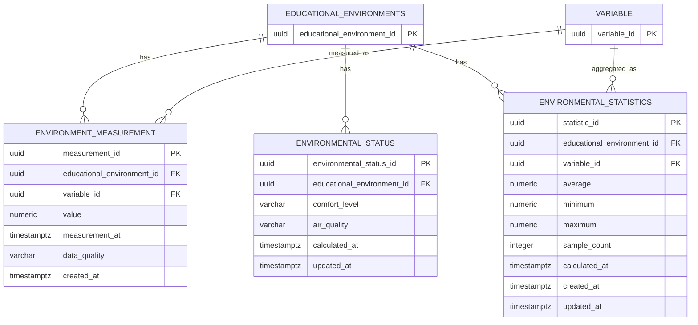

# Environmental Monitoring — Data Model

## 1. Overview

The Environmental Monitoring domain is responsible for storing environmental measurements collected from sensors and maintaining the current environmental status of educational environments.

Its main responsibilities are:

* Storing historical environmental measurements.
* Associating measurements with educational environments and variables.
* Recording measurement data quality.
* Maintaining the calculated environmental status of an educational environment.
* Providing aggregated environmental statistics for operational queries.

EduAirControl currently uses a **monolithic architecture with a centralized PostgreSQL 15 database**. Therefore, physical foreign keys can be used between entities belonging to different domains.

Although the database is shared, domain ownership is maintained at the application level.

---

## 2. Database Design

```dbml
Project EnvironmentalMonitoring {
  database_type: 'PostgreSQL'
  Note: 'Environmental measurements, environmental status and operational statistics'
}

Table environment_measurement {
  measurement_id uuid [pk, default: `gen_random_uuid()`]
  educational_environment_id uuid [not null]
  variable_id uuid [not null]
  value numeric(12,4) [not null]
  measurement_at timestamptz [not null]
  data_quality varchar(30) [not null, default: 'VALID']
  created_at timestamptz [not null, default: `now()`]

  indexes {
    educational_environment_id
    variable_id
    measurement_at
    (educational_environment_id, variable_id, measurement_at)
  }
}

Table environmental_status {
 environmental_status_id uuid [pk, default: `gen_random_uuid()`]
  educational_environment_id uuid [not null]
  comfort_level varchar(30)
  air_quality varchar(30)
  calculated_at timestamptz [not null]
  updated_at timestamptz [not null, default: `now()`]

  indexes {
    educational_environment_id
    calculated_at
  }
}

Table environmental_statistics {
  statistic_id uuid [pk, default: `gen_random_uuid()`]
  educational_environment_id uuid [not null]
  variable_id uuid [not null]
  average numeric(12,4)
  maximum numeric(12,4)
  minimum numeric(12,4)
  sample_count integer
  calculated_at timestamptz [not null]
  created_at timestamptz [not null, default: `now()`]
  updated_at timestamptz [not null, default: `now()`]

  indexes {
    educational_environment_id
    variable_id
    calculated_at
    (educational_environment_id, variable_id)
  }
}

Ref: environment_measurement.educational_environment_id > educational_environments.educational_environment_id
Ref: environment_measurement.variable_id > variable.variable_id

Ref: environmental_status.educational_environment_id > educational_environments.educational_environment_id

Ref: environmental_statistics.educational_environment_id > educational_environments.educational_environment_id
Ref: environmental_statistics.variable_id > variable.variable_id
```

---

## 3. Naming Standardization

The original model used:

```text
variable_history
environment_id
```

The model is standardized to:

```text
environment_measurement
educational_environment_id
```

This provides consistency with the rest of the EduAirControl database.

The canonical environmental measurement entity is:

```text
environment_measurement
```

and its relationship to the monitored location is:

```text
environment_measurement.educational_environment_id
    →
educational_environments.educational_environment_id
```

The same naming convention should be used by other domains that reference an educational environment.

---

## 4. Cross-Domain References

Because EduAirControl currently uses a **single centralized PostgreSQL database**, these relationships can be implemented using physical foreign keys.

### Measurement

```text
environment_measurement.educational_environment_id
    →
educational_environments.educational_environment_id

environment_measurement.variable_id
    →
variable.variable_id
```

### Environmental Status

```text
environmental_status.educational_environment_id
    →
educational_environments.educational_environment_id
```

### Environmental Statistics

```text
environmental_statistics.educational_environment_id
    →
educational_environments.educational_environment_id

environmental_statistics.variable_id
    →
variable.variable_id
```

These foreign keys provide database-level referential integrity.

However, physical relationships do not change domain ownership.

For example:

```text
Classroom Management
    owns → educational_environments

Sensor / Variable Management
    owns → variable

Environmental Monitoring
    owns → environment_measurement
    owns → environmental_status
    owns → environmental_statistics
```

---

## 5. Environment Measurements

`environment_measurement` stores the historical measurements collected from sensors.

Each measurement represents a value associated with:

* One educational environment.
* One environmental variable.
* One collection timestamp.
* One data-quality state.

Conceptually:

```text
Sensor
  │
  │ produces
  ▼
Measurement
  │
  ├── Variable
  ├── Educational Environment
  ├── Value
  ├── Measurement Time
  └── Data Quality
```

Example:

```text
educational_environment: Classroom A
variable: CO2
value: 742.0000
measurement_at: 2026-09-09 10:30:00-05
data_quality: VALID
```

The original collection timestamp must be preserved because measurements are historical telemetry data.

---

## 6. Measurement Data Quality

The `data_quality` field indicates whether the measurement can be considered reliable.

Recommended values:

```text
VALID
INVALID
SUSPECT
MISSING
```

These values should be documented as part of the measurement business rules.

A possible PostgreSQL constraint is:

```sql
CHECK (
    data_quality IN (
        'VALID',
        'INVALID',
        'SUSPECT',
        'MISSING'
    )
)
```

The exact rules for assigning each state belong to the measurement ingestion and validation logic.

---

## 7. Measurement Constraints

The following constraints are recommended.

### Measurement value

```text
value IS NOT NULL
```

A measurement must always have a value.

However, the acceptable numerical range should **not** be hardcoded universally in this table because different variables have different valid ranges.

For example:

```text
Temperature → temperature-specific validation
CO2         → CO2-specific validation
Humidity    → humidity-specific validation
Noise       → noise-specific validation
```

These rules should be associated with the variable configuration rather than applying one global range to every measurement.

---

### Measurement timestamp

```text
measurement_at IS NOT NULL
```

The original measurement timestamp is mandatory.

This allows the system to correctly:

* Query historical measurements.
* Calculate averages.
* Generate statistics.
* Detect threshold exceedances.
* Generate environmental analyses.
* Build rankings.

---

## 8. Environmental Status

`environmental_status` represents the calculated current environmental condition of an educational environment.

It is derived from recent environmental measurements and configured business rules.

Possible concepts include:

```text
comfort_level
air_quality
```

Example:

```text
Educational Environment
        │
        │ recent measurements
        ▼
Environmental Status
        │
        ├── Comfort Level
        └── Air Quality
```

The status is calculated at a specific point in time:

```text
calculated_at
```

This timestamp indicates when the status calculation was performed.

---

## 9. Environmental Status Constraints

Recommended values for `comfort_level` could include:

```text
GOOD
ACCEPTABLE
POOR
```

Recommended values for `air_quality` could include:

```text
GOOD
MODERATE
POOR
```

These values are examples and should be aligned with the project's final environmental classification rules.

The system should avoid treating `comfort_level` and `air_quality` as raw sensor measurements.

They are **derived values** calculated from one or more measurements.

---

## 10. Environmental Statistics

`environmental_statistics` stores aggregated values that can be used for operational dashboards and queries.

For a specific educational environment and variable, the entity can store:

```text
average
minimum
maximum
sample_count
calculated_at
```

Conceptually:

```text
environment_measurement
        │
        │ aggregation
        ▼
environmental_statistics
```

Example:

```text
Variable: Temperature

Average: 23.4500
Minimum: 21.8000
Maximum: 25.1000
Sample Count: 120
```

The statistics table stores derived information and does not replace the raw measurement history.

---

## 11. Statistics Constraints

The following relationship must be maintained:

```text
minimum <= maximum
```

When both values are available:

```sql
CHECK (
    minimum IS NULL
    OR maximum IS NULL
    OR minimum <= maximum
)
```

If `sample_count` is included, it should satisfy:

```sql
CHECK (
    sample_count IS NULL
    OR sample_count >= 0
)
```

If the application requires `average`, `minimum`, and `maximum` to always exist after a successful calculation, those fields can instead be defined as `NOT NULL`.

---

## 12. Statistics and Environmental Analysis

`environmental_statistics` and `environmental_analysis` have different responsibilities.

### Environmental Statistics

Provides aggregated operational information:

```text
Average
Minimum
Maximum
Sample Count
```

It is useful for:

* Dashboards.
* Quick summaries.
* Current operational views.
* Frequently requested aggregations.

### Environmental Analysis

Provides analysis for a defined period:

```text
period_start
period_end
analysis_status
requested_by
computed_at
```

with results such as:

```text
min_value
max_value
avg_value
sample_count
exceedance_count
```

Therefore:

```text
Measurements
     │
     ├──────────────► Environmental Statistics
     │
     └──────────────► Environmental Analysis
```

The raw measurements remain the source of truth.

---

## 13. Data Retention

Environmental measurements can grow rapidly because EduAirControl is an IoT system.

The measurement table should therefore be designed with historical querying and future scaling in mind.

Recommended considerations include:

* Index measurements by educational environment.
* Index measurements by variable.
* Index `measurement_at`.
* Avoid unnecessary indexes because measurements can be inserted frequently.
* Define a future retention policy according to project requirements.
* Consider table partitioning if the volume becomes sufficiently large.

Partitioning is **not required for the initial implementation**.

---

## 14. Indexing Strategy

Recommended indexes include:

### Measurements

```text
educational_environment_id
variable_id
measurement_at
(educational_environment_id, variable_id, measurement_at)
```

These support queries such as:

```text
Get measurements for an environment.
Get measurements for a variable.
Get measurements within a period.
Get measurements for a variable in an environment during a period.
```

Because this table can receive a large number of inserts, indexes should be kept purposeful.

### Environmental Status

```text
educational_environment_id
calculated_at
```

### Environmental Statistics

```text
educational_environment_id
variable_id
calculated_at
```

---

## 15. Domain Events

Potential events produced by this domain include:

```text
MeasurementRecorded
EnvironmentalStatusCalculated
EnvironmentalStatusChanged
EnvironmentalStatisticsCalculated
```

Potential events consumed from other domains include:

```text
SensorRegistered
SensorStatusChanged
VariableConfigurationUpdated
EducationalEnvironmentStatusChanged
```

Because EduAirControl is currently monolithic, these events can initially be implemented as **internal domain/application events**.

If the system is later divided into microservices, these events can be exposed through the selected messaging infrastructure.

---

## 16. Domain Boundary

The Environmental Monitoring domain owns:

```text
environment_measurement
environmental_status
environmental_statistics
```

It does not own:

```text
educational_environments
variable
sensor
```

Those entities belong to their respective domains.

The domain may read and reference them through the centralized database, but changes to their master data should follow the rules of their owning domains.

---

## 17. PostgreSQL Considerations

EduAirControl uses:

```text
PostgreSQL 15
```

UUID generation can use:

```sql
CREATE EXTENSION IF NOT EXISTS pgcrypto;
```

UUIDs can then be generated using:

```sql
gen_random_uuid()
```

Temporal fields use:

```text
TIMESTAMPTZ
```

This applies to:

```text
measurement_at
calculated_at
created_at
updated_at
```

The original measurement timestamp must not be replaced by `created_at`.

The distinction is:

```text
measurement_at → when the sensor measurement occurred

created_at      → when the database record was created
```

---

## 18. Migration Strategy

All schema changes must be managed using **Liquibase**.

Recommended structure:

```text
src/main/resources/db/
├── changelog/
│   ├── db.changelog-master.yaml
│   └── changes/
│       ├── 001-create-environment-measurement.yaml
│       ├── 002-create-environmental-status.yaml
│       ├── 003-create-environmental-statistics.yaml
│       └── 004-add-monitoring-constraints.yaml
```

Example master changelog:

```yaml
databaseChangeLog:

  - include:
      file: db/changelog/changes/001-create-environment-measurement.yaml

  - include:
      file: db/changelog/changes/002-create-environmental-status.yaml

  - include:
      file: db/changelog/changes/003-create-environmental-statistics.yaml

  - include:
      file: db/changelog/changes/004-add-monitoring-constraints.yaml
```

### Liquibase rules

* Use Liquibase for all database schema changes.
* Each changeset should represent one logical change.
* Do not modify already executed changesets.
* Create new changesets for corrections.
* Define foreign keys through Liquibase.
* Define indexes through Liquibase.
* Define database constraints through Liquibase.
* Keep migration files under version control.
* Do not manually modify the database schema.
* Use forward-only migrations.

Liquibase maintains its migration history using:

```text
DATABASECHANGELOG
DATABASECHANGELOGLOCK
```

---

## 19. Entity Relationship Diagram



---

## 20. Future Telemetry Consideration

Because EduAirControl is an IoT system, the number of measurements may increase significantly over time.

The current PostgreSQL model is appropriate for the planning and initial implementation stage.

If the measurement volume becomes sufficiently large, the system can evolve toward:

```text
Current architecture

Sensors
   │
   ▼
Environmental Monitoring
   │
   ▼
PostgreSQL
```

and potentially:

```text
Future architecture

Sensors
   │
   ▼
Telemetry / Ingestion
   │
   ├──► PostgreSQL
   │
   └──► Time-Series Storage
```

This evolution does not change the ownership of:

```text
educational_environments
variable
```

Those entities remain managed by their respective domains.

A dedicated Telemetry Service or time-series database should only be introduced when measurement volume, query performance, or retention requirements justify the additional architectural complexity.

---

## 21. Domain Fit

The Environmental Monitoring domain fits into EduAirControl as follows:

```text
Classroom Management
        │
        │ educational_environment
        ▼
Environmental Monitoring
        │
        ├── environment_measurement
        ├── environmental_status
        └── environmental_statistics
                │
                ▼
        Analytics / Analysis
                │
                ├── rankings
                └── environmental_analysis
```

The important architectural principle is:

> **EduAirControl uses a monolithic database, but domain responsibilities remain separated.**

Physical foreign keys are therefore allowed and recommended where they provide referential integrity, while application-level domain boundaries determine which module is responsible for creating, updating, and validating each entity.
