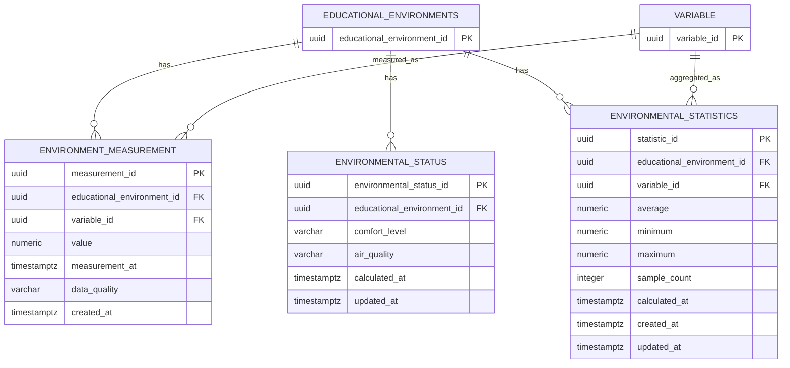

# Environmental Monitoring — Data Model

> This document reflects the real project domain: the monitoring model is centered on environmental readings, threshold-based analysis, and alerts, not on a generic status table.
> The legacy file name retains the old `enviroment` typo; the canonical business name in the database and domain is `environment`.

---

## 1. Overview

The Environmental Monitoring domain is responsible for:

- storing the historical measurements produced by sensors,
- associating each reading with a sensor installation, a variable, and an instant in time,
- evaluating thresholds by environment type and variable,
- calculating analyses for a defined period,
- creating alerts when an environmental condition exceeds the configured rule.

The core model is therefore centered on:

- `environment_measurement`
- `variable_threshold`
- `environmental_analysis`
- `analysis_result`
- `environment_alert`

The domain must remain aligned with the domain model in 02 and with the project’s real business purpose: monitoring air quality in educational spaces.

---

## 2. Canonical domain model

```dbml
Project EnvironmentalMonitoring {
  database_type: 'PostgreSQL'
  Note: 'Core monitoring model for educational environments'
}

Table educational_environment {
  educational_environment_id uuid [pk, default: `gen_random_uuid()`]
  campus_id uuid [not null]
  code varchar(30) [not null]
  name varchar(120) [not null]
  environment_type_id uuid [not null]
  floor_area_m2 numeric(8,2)
  occupancy_capacity smallint
}

Table sensor {
  sensor_id uuid [pk, default: `gen_random_uuid()`]
  serial_number varchar(60) [not null, unique]
  sensor_model_id uuid [not null]
  sensor_status_id uuid [not null]
  last_seen_at timestamptz
}

Table sensor_installation {
  sensor_installation_id uuid [pk, default: `gen_random_uuid()`]
  sensor_id uuid [not null]
  educational_environment_id uuid [not null]
  installed_at timestamptz [not null]
  removed_at timestamptz
}

Table variable {
  variable_id uuid [pk, default: `gen_random_uuid()`]
  code varchar(30) [not null, unique]
  name varchar(80) [not null]
  unit_id uuid [not null]
}

Table sensor_variable {
  sensor_id uuid [pk, not null]
  variable_id uuid [pk, not null]
}

Table variable_threshold {
  variable_threshold_id uuid [pk, default: `gen_random_uuid()`]
  variable_id uuid [not null]
  environment_type_id uuid [not null]
  min_value numeric(12,4)
  max_value numeric(12,4)
  severity_id uuid [not null]
  valid_from date [not null]
  valid_to date
}

Table environment_measurement {
  environment_measurement_id uuid [pk, default: `gen_random_uuid()`]
  sensor_installation_id uuid [not null]
  variable_id uuid [not null]
  measured_value numeric(12,4) [not null]
  measured_at timestamptz [not null]
  quality_flag_id uuid [not null]
}

Table environmental_analysis {
  environmental_analysis_id uuid [pk, default: `gen_random_uuid()`]
  educational_environment_id uuid [not null]
  period_start timestamptz [not null]
  period_end timestamptz [not null]
  analysis_status_id uuid [not null]
  requested_by uuid
  computed_at timestamptz
}

Table analysis_result {
  analysis_result_id uuid [pk, default: `gen_random_uuid()`]
  environmental_analysis_id uuid [not null]
  variable_id uuid [not null]
  min_value numeric(12,4) [not null]
  max_value numeric(12,4) [not null]
  avg_value numeric(12,4) [not null]
  sample_count integer [not null]
  exceedance_count integer [not null]
}

Table environment_alert {
  environment_alert_id uuid [pk, default: `gen_random_uuid()`]
  educational_environment_id uuid [not null]
  variable_id uuid [not null]
  variable_threshold_id uuid [not null]
  triggering_measurement_id uuid [not null]
  raised_at timestamptz [not null, default: `now()`]
  acknowledged_at timestamptz
  acknowledged_by uuid
}
```

---

## 3. Naming and domain rules

The model must use the following conventions:

```text
Tables:        snake_case, singular nouns
Columns:       snake_case
PKs:           <table_name>_id
FKs:           <referenced_table>_id
Time stamps:   TIMESTAMPTZ
English terms: always in English
```

Examples:

```text
educational_environment
sensor_installation
environment_measurement
variable_threshold
analysis_result
environment_alert
```

These names are the canonical names for the project. Any legacy variant such as `variable_history`, `environment_id`, or `enviroment_*` must be considered deprecated and replaced when touched.

---

## 4. Core business rules

### 4.1 Measurement is atomic

`environment_measurement` stores exactly one value per installation, variable, and instant.

```sql
-- One row = one sensor installation + one variable + one timestamp
```

This prohibits wide rows like:

```text
co2, temp, humidity, noise
```

in the same table row, because those would violate the 1NF principle and make schema evolution harder.

### 4.2 Thresholds are time-valid and referenced by foreign key

`variable_threshold` stores the threshold rule by variable and environment type, with validity dates.

```text
variable_id
environment_type_id
min_value
max_value
valid_from
valid_to
```

The threshold is not duplicated into each measurement; instead, the alert or analysis resolves the active threshold at query time.

### 4.3 Analysis is period-based

`environmental_analysis` materializes the period being analyzed:

```text
period_start
period_end
```

Each analysis can produce multiple `analysis_result` rows, one per variable.

### 4.4 Alerts remain traceable

`environment_alert` references:

- the environment,
- the variable,
- the threshold that was active,
- the measurement that triggered the condition.

The alert is not a copy of the measurement; it is a traceable event based on that measurement.

---

## 5. Direct relations

```text
educational_environment 1 ─── N sensor_installation
sensor 1 ─── N sensor_installation
sensor_installation 1 ─── N environment_measurement
variable 1 ─── N environment_measurement
variable 1 ─── N variable_threshold
environment_type 1 ─── N variable_threshold
educational_environment 1 ─── N environmental_analysis
environmental_analysis 1 ─── N analysis_result
variable 1 ─── N analysis_result
educational_environment 1 ─── N environment_alert
variable 1 ─── N environment_alert
variable_threshold 1 ─── N environment_alert
environment_measurement 1 ─── N environment_alert
```

---

## 6. Direct consequences for 06

The asset should not live as a generic template or a legacy summary without the project’s actual purpose. The critical missing tables are:

- `environment_measurement`
- `variable_threshold`
- `environmental_analysis`
- `analysis_result`
- `environment_alert`

The project is not primarily a sensor catalog or IAM data model; it is an environmental monitoring system for educational environments.

This is the main correction required in 06: the model must reflect the actual business domain, not the implementation scaffolding that was copied into `06-data/models.md` and partially reused in the monitoring document.

---

## 7. Recommended implementation notes

- Keep historical measurements immutable from the point of insertion.
- Use `TIMESTAMPTZ` to preserve the original measurement instant.
- Prefer `BIGSERIAL` for high-volume fact tables such as measurements and alerts.
- Use explanatory numeric precision (`NUMERIC(12,4)`) for readings and aggregated values.
- Ensure indexes are built for `(sensor_installation_id, variable_id, measured_at)` and for environment/time queries.
- Maintain the same audit pattern used across the project: creation, modification, and soft-deletion metadata.

---

## 8. Final conclusion

The appropriate structure for 06 is a relational model based on the domain’s actual use case: environment, sensor, measurement, analysis, and alert. The data model should be normalized, traceable, and explicit about the actual meaning of each table and relation.

### Measurement value

```text
value IS NOT NULL
```

A measurement must always have a value.

However, the acceptable numerical range should **not** be hardcoded universally in this table because different variables have different valid ranges.

For example:

```text
Temperature → temperature-specific validation
CO2         → CO2-specific validation
Humidity    → humidity-specific validation
Noise       → noise-specific validation
```

These rules should be associated with the variable configuration rather than applying one global range to every measurement.

---

### Measurement timestamp

```text
measurement_at IS NOT NULL
```

The original measurement timestamp is mandatory.

This allows the system to correctly:

* Query historical measurements.
* Calculate averages.
* Generate statistics.
* Detect threshold exceedances.
* Generate environmental analyses.
* Build rankings.

---

## 8. Environmental Status

`environmental_status` represents the calculated current environmental condition of an educational environment.

It is derived from recent environmental measurements and configured business rules.

Possible concepts include:

```text
comfort_level
air_quality
```

Example:

```text
Educational Environment
        │
        │ recent measurements
        ▼
Environmental Status
        │
        ├── Comfort Level
        └── Air Quality
```

The status is calculated at a specific point in time:

```text
calculated_at
```

This timestamp indicates when the status calculation was performed.

---

## 9. Environmental Status Constraints

Recommended values for `comfort_level` could include:

```text
GOOD
ACCEPTABLE
POOR
```

Recommended values for `air_quality` could include:

```text
GOOD
MODERATE
POOR
```

These values are examples and should be aligned with the project's final environmental classification rules.

The system should avoid treating `comfort_level` and `air_quality` as raw sensor measurements.

They are **derived values** calculated from one or more measurements.

---

## 10. Environmental Statistics

`environmental_statistics` stores aggregated values that can be used for operational dashboards and queries.

For a specific educational environment and variable, the entity can store:

```text
average
minimum
maximum
sample_count
calculated_at
```

Conceptually:

```text
environment_measurement
        │
        │ aggregation
        ▼
environmental_statistics
```

Example:

```text
Variable: Temperature

Average: 23.4500
Minimum: 21.8000
Maximum: 25.1000
Sample Count: 120
```

The statistics table stores derived information and does not replace the raw measurement history.

---

## 11. Statistics Constraints

The following relationship must be maintained:

```text
minimum <= maximum
```

When both values are available:

```sql
CHECK (
    minimum IS NULL
    OR maximum IS NULL
    OR minimum <= maximum
)
```

If `sample_count` is included, it should satisfy:

```sql
CHECK (
    sample_count IS NULL
    OR sample_count >= 0
)
```

If the application requires `average`, `minimum`, and `maximum` to always exist after a successful calculation, those fields can instead be defined as `NOT NULL`.

---

## 12. Statistics and Environmental Analysis

`environmental_statistics` and `environmental_analysis` have different responsibilities.

### Environmental Statistics

Provides aggregated operational information:

```text
Average
Minimum
Maximum
Sample Count
```

It is useful for:

* Dashboards.
* Quick summaries.
* Current operational views.
* Frequently requested aggregations.

### Environmental Analysis

Provides analysis for a defined period:

```text
period_start
period_end
analysis_status
requested_by
computed_at
```

with results such as:

```text
min_value
max_value
avg_value
sample_count
exceedance_count
```

Therefore:

```text
Measurements
     │
     ├──────────────► Environmental Statistics
     │
     └──────────────► Environmental Analysis
```

The raw measurements remain the source of truth.

---

## 13. Data Retention

Environmental measurements can grow rapidly because EduAirControl is an IoT system.

The measurement table should therefore be designed with historical querying and future scaling in mind.

Recommended considerations include:

* Index measurements by educational environment.
* Index measurements by variable.
* Index `measurement_at`.
* Avoid unnecessary indexes because measurements can be inserted frequently.
* Define a future retention policy according to project requirements.
* Consider table partitioning if the volume becomes sufficiently large.

Partitioning is **not required for the initial implementation**.

---

## 14. Indexing Strategy

Recommended indexes include:

### Measurements

```text
educational_environment_id
variable_id
measurement_at
(educational_environment_id, variable_id, measurement_at)
```

These support queries such as:

```text
Get measurements for an environment.
Get measurements for a variable.
Get measurements within a period.
Get measurements for a variable in an environment during a period.
```

Because this table can receive a large number of inserts, indexes should be kept purposeful.

### Environmental Status

```text
educational_environment_id
calculated_at
```

### Environmental Statistics

```text
educational_environment_id
variable_id
calculated_at
```

---

## 15. Domain Events

Potential events produced by this domain include:

```text
MeasurementRecorded
EnvironmentalStatusCalculated
EnvironmentalStatusChanged
EnvironmentalStatisticsCalculated
```

Potential events consumed from other domains include:

```text
SensorRegistered
SensorStatusChanged
VariableConfigurationUpdated
EducationalEnvironmentStatusChanged
```

Because EduAirControl is currently monolithic, these events can initially be implemented as **internal domain/application events**.

If the system is later divided into microservices, these events can be exposed through the selected messaging infrastructure.

---

## 16. Domain Boundary

The Environmental Monitoring domain owns:

```text
environment_measurement
environmental_status
environmental_statistics
```

It does not own:

```text
educational_environments
variable
sensor
```

Those entities belong to their respective domains.

The domain may read and reference them through the centralized database, but changes to their master data should follow the rules of their owning domains.

---

## 17. PostgreSQL Considerations

EduAirControl uses:

```text
PostgreSQL 15
```

UUID generation can use:

```sql
CREATE EXTENSION IF NOT EXISTS pgcrypto;
```

UUIDs can then be generated using:

```sql
gen_random_uuid()
```

Temporal fields use:

```text
TIMESTAMPTZ
```

This applies to:

```text
measurement_at
calculated_at
created_at
updated_at
```

The original measurement timestamp must not be replaced by `created_at`.

The distinction is:

```text
measurement_at → when the sensor measurement occurred

created_at      → when the database record was created
```

---

## 18. Migration Strategy

All schema changes must be managed using **Liquibase**.

Recommended structure:

```text
src/main/resources/db/
├── changelog/
│   ├── db.changelog-master.yaml
│   └── changes/
│       ├── 001-create-environment-measurement.yaml
│       ├── 002-create-environmental-status.yaml
│       ├── 003-create-environmental-statistics.yaml
│       └── 004-add-monitoring-constraints.yaml
```

Example master changelog:

```yaml
databaseChangeLog:

  - include:
      file: db/changelog/changes/001-create-environment-measurement.yaml

  - include:
      file: db/changelog/changes/002-create-environmental-status.yaml

  - include:
      file: db/changelog/changes/003-create-environmental-statistics.yaml

  - include:
      file: db/changelog/changes/004-add-monitoring-constraints.yaml
```

### Liquibase rules

* Use Liquibase for all database schema changes.
* Each changeset should represent one logical change.
* Do not modify already executed changesets.
* Create new changesets for corrections.
* Define foreign keys through Liquibase.
* Define indexes through Liquibase.
* Define database constraints through Liquibase.
* Keep migration files under version control.
* Do not manually modify the database schema.
* Use forward-only migrations.

Liquibase maintains its migration history using:

```text
DATABASECHANGELOG
DATABASECHANGELOGLOCK
```

---

## 19. Entity Relationship Diagram



---

## 20. Future Telemetry Consideration

Because EduAirControl is an IoT system, the number of measurements may increase significantly over time.

The current PostgreSQL model is appropriate for the planning and initial implementation stage.

If the measurement volume becomes sufficiently large, the system can evolve toward:

```text
Current architecture

Sensors
   │
   ▼
Environmental Monitoring
   │
   ▼
PostgreSQL
```

and potentially:

```text
Future architecture

Sensors
   │
   ▼
Telemetry / Ingestion
   │
   ├──► PostgreSQL
   │
   └──► Time-Series Storage
```

This evolution does not change the ownership of:

```text
educational_environments
variable
```

Those entities remain managed by their respective domains.

A dedicated Telemetry Service or time-series database should only be introduced when measurement volume, query performance, or retention requirements justify the additional architectural complexity.

---

## 21. Domain Fit

The Environmental Monitoring domain fits into EduAirControl as follows:

```text
Classroom Management
        │
        │ educational_environment
        ▼
Environmental Monitoring
        │
        ├── environment_measurement
        ├── environmental_status
        └── environmental_statistics
                │
                ▼
        Analytics / Analysis
                │
                ├── rankings
                └── environmental_analysis
```

The important architectural principle is:

> **EduAirControl uses a monolithic database, but domain responsibilities remain separated.**

Physical foreign keys are therefore allowed and recommended where they provide referential integrity, while application-level domain boundaries determine which module is responsible for creating, updating, and validating each entity.
