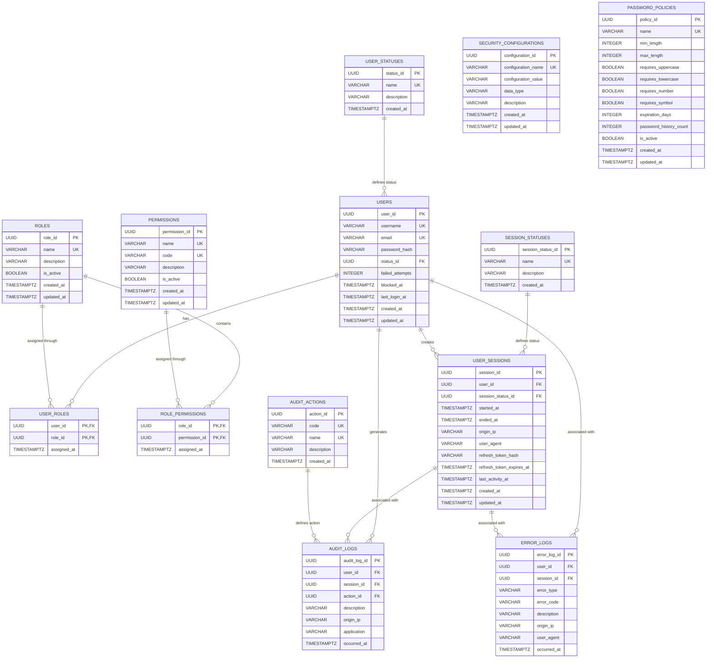

# IAM Service — Data Model

## 1. Service

**Service Name:** IAM Service
**Domain:** Identity and Access Management
**Database Engine:** PostgreSQL 15

The IAM Service is responsible for managing user identities, authentication, authorization, sessions, security policies, password policies, auditing, and security-related errors.

The database follows a normalized relational model and is designed to support the future evolution of the system toward a microservice-oriented architecture.

---

# 2. Database Engine

## 2.1 Selected Database Engine

**PostgreSQL 15**

## 2.2 Engine Justification

PostgreSQL 15 was selected for the IAM Service because it provides:

* Strong ACID transaction guarantees.
* Referential integrity through foreign keys.
* Native support for UUID identifiers.
* Advanced indexing capabilities.
* Strong support for relational and normalized data models.
* Robust transaction management.
* Native `BOOLEAN`, `TIMESTAMPTZ`, and JSON-related capabilities.
* Support for database constraints.
* Good compatibility with Java and Spring Boot.
* Mature support for migration tools such as Flyway and Liquibase.
* Suitable performance for authentication, authorization, session management, and audit operations.

PostgreSQL also provides the reliability required for security-sensitive information such as users, roles, permissions, sessions, and audit records.

---

# 3. PostgreSQL Configuration

## 3.1 Required Extension

The database uses PostgreSQL's `pgcrypto` extension to generate UUID values.

```sql
CREATE EXTENSION IF NOT EXISTS pgcrypto;
```

UUIDs are generated using:

```sql
gen_random_uuid()
```

---

# 4. Database Naming Convention

All database identifiers use English and follow `snake_case`.

### Tables

Tables use plural nouns:

```text
users
roles
permissions
user_roles
role_permissions
user_statuses
session_statuses
user_sessions
audit_actions
audit_logs
error_logs
security_configurations
password_policies
```

### Columns

Columns also use `snake_case`.

Examples:

```text
user_id
created_at
updated_at
failed_attempts
last_login_at
refresh_token_hash
```

### Primary Keys

Primary keys follow:

```text
<table_name_singular>_id
```

Examples:

```text
user_id
role_id
permission_id
session_id
```

### Foreign Keys

Foreign keys use the referenced entity name followed by `_id`.

Examples:

```text
status_id
user_id
role_id
permission_id
session_status_id
action_id
```

---

# 5. Database Tables

The IAM Service contains **13 tables**.

1. `user_statuses`
2. `users`
3. `roles`
4. `user_roles`
5. `permissions`
6. `role_permissions`
7. `session_statuses`
8. `user_sessions`
9. `audit_actions`
10. `audit_logs`
11. `error_logs`
12. `security_configurations`
13. `password_policies`

---

# 6. Table: user_statuses

## Purpose

Stores the possible lifecycle states of a user account.

Examples of possible states include:

* ACTIVE
* INACTIVE
* BLOCKED
* PENDING
* SUSPENDED

## SQL

```sql
CREATE TABLE user_statuses (
    status_id UUID PRIMARY KEY DEFAULT gen_random_uuid(),
    name VARCHAR(50) NOT NULL UNIQUE,
    description VARCHAR(255),
    created_at TIMESTAMPTZ NOT NULL DEFAULT CURRENT_TIMESTAMP
);
```

## Data Dictionary

| Column        | Type         | Constraints      | Description                                |
| ------------- | ------------ | ---------------- | ------------------------------------------ |
| `status_id`   | UUID         | PK               | Unique identifier of the user status.      |
| `name`        | VARCHAR(50)  | NOT NULL, UNIQUE | Status name.                               |
| `description` | VARCHAR(255) | NULL             | Description of the status.                 |
| `created_at`  | TIMESTAMPTZ  | NOT NULL         | Date and time when the status was created. |

## Modeling Decisions

A separate status table avoids storing arbitrary status strings directly in the `users` table.

This allows the application to maintain controlled and extensible user states.

---

# 7. Table: users

## Purpose

Stores the identity and authentication information of system users.

## SQL

```sql
CREATE TABLE users (
    user_id UUID PRIMARY KEY DEFAULT gen_random_uuid(),
    username VARCHAR(100) NOT NULL UNIQUE,
    email VARCHAR(150) NOT NULL UNIQUE,
    password_hash VARCHAR(255) NOT NULL,
    status_id UUID NOT NULL,
    failed_attempts INTEGER NOT NULL DEFAULT 0,
    blocked_at TIMESTAMPTZ,
    last_login_at TIMESTAMPTZ,
    created_at TIMESTAMPTZ NOT NULL DEFAULT CURRENT_TIMESTAMP,
    updated_at TIMESTAMPTZ,

    CONSTRAINT fk_users_status
        FOREIGN KEY (status_id)
        REFERENCES user_statuses(status_id)
);
```

## Indexes

```sql
CREATE INDEX idx_users_status_id
    ON users(status_id);
```

The unique constraints on `username` and `email` automatically create unique indexes.

## Data Dictionary

| Column            | Type         | Constraints         | Description                                           |
| ----------------- | ------------ | ------------------- | ----------------------------------------------------- |
| `user_id`         | UUID         | PK                  | Unique user identifier.                               |
| `username`        | VARCHAR(100) | NOT NULL, UNIQUE    | User's login name.                                    |
| `email`           | VARCHAR(150) | NOT NULL, UNIQUE    | User's email address.                                 |
| `password_hash`   | VARCHAR(255) | NOT NULL            | Secure password hash.                                 |
| `status_id`       | UUID         | NOT NULL, FK        | Current user account status.                          |
| `failed_attempts` | INTEGER      | NOT NULL, DEFAULT 0 | Number of consecutive failed authentication attempts. |
| `blocked_at`      | TIMESTAMPTZ  | NULL                | Date and time when the account was blocked.           |
| `last_login_at`   | TIMESTAMPTZ  | NULL                | Date and time of the user's last successful login.    |
| `created_at`      | TIMESTAMPTZ  | NOT NULL            | Account creation timestamp.                           |
| `updated_at`      | TIMESTAMPTZ  | NULL                | Last account update timestamp.                        |

## Modeling Decisions

Passwords are never stored in plain text.

Only the password hash is persisted.

UUIDs are used instead of sequential numeric identifiers to avoid predictable identifiers and provide better compatibility with distributed architectures.

---

# 8. Table: roles

## Purpose

Stores authorization roles assigned to users.

Examples include:

* ADMINISTRATOR
* TEACHER
* STUDENT
* MONITOR
* USER

## SQL

```sql
CREATE TABLE roles (
    role_id UUID PRIMARY KEY DEFAULT gen_random_uuid(),
    name VARCHAR(100) NOT NULL UNIQUE,
    description VARCHAR(255),
    is_active BOOLEAN NOT NULL DEFAULT TRUE,
    created_at TIMESTAMPTZ NOT NULL DEFAULT CURRENT_TIMESTAMP,
    updated_at TIMESTAMPTZ
);
```

## Data Dictionary

| Column        | Type         | Constraints            | Description                                 |
| ------------- | ------------ | ---------------------- | ------------------------------------------- |
| `role_id`     | UUID         | PK                     | Unique role identifier.                     |
| `name`        | VARCHAR(100) | NOT NULL, UNIQUE       | Role name.                                  |
| `description` | VARCHAR(255) | NULL                   | Role description.                           |
| `is_active`   | BOOLEAN      | NOT NULL, DEFAULT TRUE | Indicates whether the role can be assigned. |
| `created_at`  | TIMESTAMPTZ  | NOT NULL               | Role creation timestamp.                    |
| `updated_at`  | TIMESTAMPTZ  | NULL                   | Last role update timestamp.                 |

---

# 9. Table: user_roles

## Purpose

Associates users with roles.

This table implements the many-to-many relationship between users and roles.

## SQL

```sql
CREATE TABLE user_roles (
    user_id UUID NOT NULL,
    role_id UUID NOT NULL,
    assigned_at TIMESTAMPTZ NOT NULL DEFAULT CURRENT_TIMESTAMP,

    CONSTRAINT pk_user_roles
        PRIMARY KEY (user_id, role_id),

    CONSTRAINT fk_user_roles_user
        FOREIGN KEY (user_id)
        REFERENCES users(user_id)
        ON DELETE CASCADE,

    CONSTRAINT fk_user_roles_role
        FOREIGN KEY (role_id)
        REFERENCES roles(role_id)
        ON DELETE CASCADE
);
```

## Indexes

```sql
CREATE INDEX idx_user_roles_role_id
    ON user_roles(role_id);
```

The composite primary key already provides an index beginning with `user_id`.

## Data Dictionary

| Column        | Type        | Constraints | Description                               |
| ------------- | ----------- | ----------- | ----------------------------------------- |
| `user_id`     | UUID        | PK, FK      | Referenced user.                          |
| `role_id`     | UUID        | PK, FK      | Assigned role.                            |
| `assigned_at` | TIMESTAMPTZ | NOT NULL    | Date and time when the role was assigned. |

## Modeling Decisions

The composite primary key prevents assigning the same role to the same user more than once.

---

# 10. Table: permissions

## Purpose

Stores individual authorization permissions.

Examples:

```text
USER_READ
USER_CREATE
USER_UPDATE
USER_DELETE
ENVIRONMENT_READ
ENVIRONMENT_UPDATE
```

## SQL

```sql
CREATE TABLE permissions (
    permission_id UUID PRIMARY KEY DEFAULT gen_random_uuid(),
    name VARCHAR(100) NOT NULL UNIQUE,
    code VARCHAR(100) NOT NULL UNIQUE,
    description VARCHAR(255),
    is_active BOOLEAN NOT NULL DEFAULT TRUE,
    created_at TIMESTAMPTZ NOT NULL DEFAULT CURRENT_TIMESTAMP,
    updated_at TIMESTAMPTZ
);
```

## Data Dictionary

| Column          | Type         | Constraints            | Description                                 |
| --------------- | ------------ | ---------------------- | ------------------------------------------- |
| `permission_id` | UUID         | PK                     | Unique permission identifier.               |
| `name`          | VARCHAR(100) | NOT NULL, UNIQUE       | Permission name.                            |
| `code`          | VARCHAR(100) | NOT NULL, UNIQUE       | Machine-readable permission code.           |
| `description`   | VARCHAR(255) | NULL                   | Permission description.                     |
| `is_active`     | BOOLEAN      | NOT NULL, DEFAULT TRUE | Indicates whether the permission is active. |
| `created_at`    | TIMESTAMPTZ  | NOT NULL               | Permission creation timestamp.              |
| `updated_at`    | TIMESTAMPTZ  | NULL                   | Last update timestamp.                      |

---

# 11. Table: role_permissions

## Purpose

Associates roles with permissions.

This table implements the many-to-many relationship between roles and permissions.

## SQL

```sql
CREATE TABLE role_permissions (
    role_id UUID NOT NULL,
    permission_id UUID NOT NULL,
    assigned_at TIMESTAMPTZ NOT NULL DEFAULT CURRENT_TIMESTAMP,

    CONSTRAINT pk_role_permissions
        PRIMARY KEY (role_id, permission_id),

    CONSTRAINT fk_role_permissions_role
        FOREIGN KEY (role_id)
        REFERENCES roles(role_id)
        ON DELETE CASCADE,

    CONSTRAINT fk_role_permissions_permission
        FOREIGN KEY (permission_id)
        REFERENCES permissions(permission_id)
        ON DELETE CASCADE
);
```

## Indexes

```sql
CREATE INDEX idx_role_permissions_permission_id
    ON role_permissions(permission_id);
```

## Data Dictionary

| Column          | Type        | Constraints | Description           |
| --------------- | ----------- | ----------- | --------------------- |
| `role_id`       | UUID        | PK, FK      | Referenced role.      |
| `permission_id` | UUID        | PK, FK      | Assigned permission.  |
| `assigned_at`   | TIMESTAMPTZ | NOT NULL    | Assignment timestamp. |

---

# 12. Table: session_statuses

## Purpose

Stores the possible states of a user session.

Examples:

```text
ACTIVE
EXPIRED
REVOKED
CLOSED
```

## SQL

```sql
CREATE TABLE session_statuses (
    session_status_id UUID PRIMARY KEY DEFAULT gen_random_uuid(),
    name VARCHAR(50) NOT NULL UNIQUE,
    description VARCHAR(255),
    created_at TIMESTAMPTZ NOT NULL DEFAULT CURRENT_TIMESTAMP
);
```

## Data Dictionary

| Column              | Type         | Constraints      | Description                       |
| ------------------- | ------------ | ---------------- | --------------------------------- |
| `session_status_id` | UUID         | PK               | Unique session status identifier. |
| `name`              | VARCHAR(50)  | NOT NULL, UNIQUE | Session status name.              |
| `description`       | VARCHAR(255) | NULL             | Status description.               |
| `created_at`        | TIMESTAMPTZ  | NOT NULL         | Creation timestamp.               |

---

# 13. Table: user_sessions

## Purpose

Stores authenticated user sessions and refresh-token information.

The table allows the IAM Service to track active sessions, revoke sessions, manage refresh tokens, and record session activity.

## SQL

```sql
CREATE TABLE user_sessions (
    session_id UUID PRIMARY KEY DEFAULT gen_random_uuid(),
    user_id UUID NOT NULL,
    session_status_id UUID NOT NULL,
    started_at TIMESTAMPTZ NOT NULL DEFAULT CURRENT_TIMESTAMP,
    ended_at TIMESTAMPTZ,
    origin_ip VARCHAR(45),
    user_agent VARCHAR(500),
    refresh_token_hash VARCHAR(255),
    refresh_token_expires_at TIMESTAMPTZ,
    last_activity_at TIMESTAMPTZ,
    created_at TIMESTAMPTZ NOT NULL DEFAULT CURRENT_TIMESTAMP,
    updated_at TIMESTAMPTZ,

    CONSTRAINT fk_user_sessions_user
        FOREIGN KEY (user_id)
        REFERENCES users(user_id),

    CONSTRAINT fk_user_sessions_status
        FOREIGN KEY (session_status_id)
        REFERENCES session_statuses(session_status_id)
);
```

## Indexes

```sql
CREATE INDEX idx_user_sessions_user_id
    ON user_sessions(user_id);

CREATE INDEX idx_user_sessions_status_id
    ON user_sessions(session_status_id);

CREATE INDEX idx_user_sessions_refresh_token_hash
    ON user_sessions(refresh_token_hash);
```

## Data Dictionary

| Column                     | Type         | Constraints  | Description                             |
| -------------------------- | ------------ | ------------ | --------------------------------------- |
| `session_id`               | UUID         | PK           | Unique session identifier.              |
| `user_id`                  | UUID         | NOT NULL, FK | User associated with the session.       |
| `session_status_id`        | UUID         | NOT NULL, FK | Current session state.                  |
| `started_at`               | TIMESTAMPTZ  | NOT NULL     | Session start timestamp.                |
| `ended_at`                 | TIMESTAMPTZ  | NULL         | Session termination timestamp.          |
| `origin_ip`                | VARCHAR(45)  | NULL         | IP address associated with the session. |
| `user_agent`               | VARCHAR(500) | NULL         | Client user-agent information.          |
| `refresh_token_hash`       | VARCHAR(255) | NULL         | Hash of the refresh token.              |
| `refresh_token_expires_at` | TIMESTAMPTZ  | NULL         | Refresh token expiration timestamp.     |
| `last_activity_at`         | TIMESTAMPTZ  | NULL         | Last recorded session activity.         |
| `created_at`               | TIMESTAMPTZ  | NOT NULL     | Record creation timestamp.              |
| `updated_at`               | TIMESTAMPTZ  | NULL         | Last record update timestamp.           |

## Security Decision

The refresh token itself must not be stored in the database.

Only its hash should be stored.

---

# 14. Table: audit_actions

## Purpose

Defines the actions that can be recorded in the audit system.

Examples:

```text
LOGIN
LOGOUT
PASSWORD_CHANGE
ROLE_ASSIGNED
ROLE_REMOVED
USER_CREATED
USER_UPDATED
```

## SQL

```sql
CREATE TABLE audit_actions (
    action_id UUID PRIMARY KEY DEFAULT gen_random_uuid(),
    code VARCHAR(100) NOT NULL UNIQUE,
    name VARCHAR(100) NOT NULL UNIQUE,
    description VARCHAR(255),
    created_at TIMESTAMPTZ NOT NULL DEFAULT CURRENT_TIMESTAMP
);
```

## Data Dictionary

| Column        | Type         | Constraints      | Description                   |
| ------------- | ------------ | ---------------- | ----------------------------- |
| `action_id`   | UUID         | PK               | Unique action identifier.     |
| `code`        | VARCHAR(100) | NOT NULL, UNIQUE | Machine-readable action code. |
| `name`        | VARCHAR(100) | NOT NULL, UNIQUE | Action name.                  |
| `description` | VARCHAR(255) | NULL             | Action description.           |
| `created_at`  | TIMESTAMPTZ  | NOT NULL         | Creation timestamp.           |

---

# 15. Table: audit_logs

## Purpose

Stores security and authorization events generated by the IAM Service.

Audit records provide traceability for important security operations.

## SQL

```sql
CREATE TABLE audit_logs (
    audit_log_id UUID PRIMARY KEY DEFAULT gen_random_uuid(),
    user_id UUID,
    session_id UUID,
    action_id UUID NOT NULL,
    description VARCHAR(500),
    origin_ip VARCHAR(45),
    application VARCHAR(255),
    occurred_at TIMESTAMPTZ NOT NULL DEFAULT CURRENT_TIMESTAMP,

    CONSTRAINT fk_audit_logs_user
        FOREIGN KEY (user_id)
        REFERENCES users(user_id)
        ON DELETE SET NULL,

    CONSTRAINT fk_audit_logs_session
        FOREIGN KEY (session_id)
        REFERENCES user_sessions(session_id)
        ON DELETE SET NULL,

    CONSTRAINT fk_audit_logs_action
        FOREIGN KEY (action_id)
        REFERENCES audit_actions(action_id)
);
```

## Indexes

```sql
CREATE INDEX idx_audit_logs_user_id
    ON audit_logs(user_id);

CREATE INDEX idx_audit_logs_session_id
    ON audit_logs(session_id);

CREATE INDEX idx_audit_logs_action_id
    ON audit_logs(action_id);

CREATE INDEX idx_audit_logs_occurred_at
    ON audit_logs(occurred_at);
```

## Data Dictionary

| Column         | Type         | Constraints  | Description                                      |
| -------------- | ------------ | ------------ | ------------------------------------------------ |
| `audit_log_id` | UUID         | PK           | Unique audit record identifier.                  |
| `user_id`      | UUID         | FK, NULL     | User associated with the event.                  |
| `session_id`   | UUID         | FK, NULL     | Session associated with the event.               |
| `action_id`    | UUID         | NOT NULL, FK | Action that generated the event.                 |
| `description`  | VARCHAR(500) | NULL         | Event description.                               |
| `origin_ip`    | VARCHAR(45)  | NULL         | Source IP address.                               |
| `application`  | VARCHAR(255) | NULL         | Application or service that generated the event. |
| `occurred_at`  | TIMESTAMPTZ  | NOT NULL     | Event timestamp.                                 |

## Modeling Decisions

`ON DELETE SET NULL` is used for user and session references so historical audit records can remain available even if the associated account or session is removed.

Audit records should generally be treated as append-only data.

---

# 16. Table: error_logs

## Purpose

Stores security-related and application-level errors generated by the IAM Service.

## SQL

```sql
CREATE TABLE error_logs (
    error_log_id UUID PRIMARY KEY DEFAULT gen_random_uuid(),
    user_id UUID,
    session_id UUID,
    error_type VARCHAR(100) NOT NULL,
    error_code VARCHAR(100),
    description VARCHAR(1000),
    origin_ip VARCHAR(45),
    user_agent VARCHAR(500),
    occurred_at TIMESTAMPTZ NOT NULL DEFAULT CURRENT_TIMESTAMP,

    CONSTRAINT fk_error_logs_user
        FOREIGN KEY (user_id)
        REFERENCES users(user_id)
        ON DELETE SET NULL,

    CONSTRAINT fk_error_logs_session
        FOREIGN KEY (session_id)
        REFERENCES user_sessions(session_id)
        ON DELETE SET NULL
);
```

## Indexes

```sql
CREATE INDEX idx_error_logs_user_id
    ON error_logs(user_id);

CREATE INDEX idx_error_logs_session_id
    ON error_logs(session_id);

CREATE INDEX idx_error_logs_error_type
    ON error_logs(error_type);

CREATE INDEX idx_error_logs_occurred_at
    ON error_logs(occurred_at);
```

## Data Dictionary

| Column         | Type          | Constraints | Description                        |
| -------------- | ------------- | ----------- | ---------------------------------- |
| `error_log_id` | UUID          | PK          | Unique error record identifier.    |
| `user_id`      | UUID          | FK, NULL    | User associated with the error.    |
| `session_id`   | UUID          | FK, NULL    | Session associated with the error. |
| `error_type`   | VARCHAR(100)  | NOT NULL    | Type of error.                     |
| `error_code`   | VARCHAR(100)  | NULL        | Application-specific error code.   |
| `description`  | VARCHAR(1000) | NULL        | Detailed error description.        |
| `origin_ip`    | VARCHAR(45)   | NULL        | Source IP address.                 |
| `user_agent`   | VARCHAR(500)  | NULL        | Client user-agent information.     |
| `occurred_at`  | TIMESTAMPTZ   | NOT NULL    | Error timestamp.                   |

---

# 17. Table: security_configurations

## Purpose

Stores configurable security parameters used by the IAM Service.

Examples:

```text
ACCESS_TOKEN_EXPIRATION
REFRESH_TOKEN_EXPIRATION
MAX_LOGIN_ATTEMPTS
SESSION_TIMEOUT
REQUIRE_HTTPS
ENABLE_AUDIT
MAX_ACTIVE_SESSIONS
```

## SQL

```sql
CREATE TABLE security_configurations (
    configuration_id UUID PRIMARY KEY DEFAULT gen_random_uuid(),
    configuration_name VARCHAR(100) NOT NULL UNIQUE,
    configuration_value VARCHAR(255) NOT NULL,
    data_type VARCHAR(30) NOT NULL,
    description VARCHAR(500),
    created_at TIMESTAMPTZ NOT NULL DEFAULT CURRENT_TIMESTAMP,
    updated_at TIMESTAMPTZ
);
```

## Data Dictionary

| Column                | Type         | Constraints      | Description                                    |
| --------------------- | ------------ | ---------------- | ---------------------------------------------- |
| `configuration_id`    | UUID         | PK               | Unique configuration identifier.               |
| `configuration_name`  | VARCHAR(100) | NOT NULL, UNIQUE | Configuration parameter name.                  |
| `configuration_value` | VARCHAR(255) | NOT NULL         | Configuration value stored as text.            |
| `data_type`           | VARCHAR(30)  | NOT NULL         | Expected data type of the configuration value. |
| `description`         | VARCHAR(500) | NULL             | Configuration description.                     |
| `created_at`          | TIMESTAMPTZ  | NOT NULL         | Creation timestamp.                            |
| `updated_at`          | TIMESTAMPTZ  | NULL             | Last update timestamp.                         |

## Modeling Decisions

The `data_type` column allows the application to interpret the stored configuration value correctly.

For example:

```text
ACCESS_TOKEN_EXPIRATION → INTEGER
REQUIRE_HTTPS → BOOLEAN
SESSION_TIMEOUT → INTEGER
```

---

# 18. Table: password_policies

## Purpose

Stores password security requirements enforced by the IAM Service.

## SQL

```sql
CREATE TABLE password_policies (
    policy_id UUID PRIMARY KEY DEFAULT gen_random_uuid(),
    name VARCHAR(100) NOT NULL UNIQUE,
    min_length INTEGER NOT NULL,
    max_length INTEGER NOT NULL,
    requires_uppercase BOOLEAN NOT NULL DEFAULT FALSE,
    requires_lowercase BOOLEAN NOT NULL DEFAULT FALSE,
    requires_number BOOLEAN NOT NULL DEFAULT FALSE,
    requires_symbol BOOLEAN NOT NULL DEFAULT FALSE,
    expiration_days INTEGER,
    password_history_count INTEGER NOT NULL DEFAULT 0,
    is_active BOOLEAN NOT NULL DEFAULT TRUE,
    created_at TIMESTAMPTZ NOT NULL DEFAULT CURRENT_TIMESTAMP,
    updated_at TIMESTAMPTZ,

    CONSTRAINT chk_password_policy_length
        CHECK (min_length > 0 AND max_length >= min_length),

    CONSTRAINT chk_password_policy_expiration
        CHECK (expiration_days IS NULL OR expiration_days > 0),

    CONSTRAINT chk_password_policy_history
        CHECK (password_history_count >= 0)
);
```

## Data Dictionary

| Column                   | Type         | Constraints      | Description                                         |
| ------------------------ | ------------ | ---------------- | --------------------------------------------------- |
| `policy_id`              | UUID         | PK               | Unique password policy identifier.                  |
| `name`                   | VARCHAR(100) | NOT NULL, UNIQUE | Policy name.                                        |
| `min_length`             | INTEGER      | NOT NULL         | Minimum password length.                            |
| `max_length`             | INTEGER      | NOT NULL         | Maximum password length.                            |
| `requires_uppercase`     | BOOLEAN      | NOT NULL         | Requires at least one uppercase character.          |
| `requires_lowercase`     | BOOLEAN      | NOT NULL         | Requires at least one lowercase character.          |
| `requires_number`        | BOOLEAN      | NOT NULL         | Requires at least one numeric character.            |
| `requires_symbol`        | BOOLEAN      | NOT NULL         | Requires at least one symbol.                       |
| `expiration_days`        | INTEGER      | NULL             | Number of days before a password expires.           |
| `password_history_count` | INTEGER      | NOT NULL         | Number of previous passwords that cannot be reused. |
| `is_active`              | BOOLEAN      | NOT NULL         | Indicates whether the policy is active.             |
| `created_at`             | TIMESTAMPTZ  | NOT NULL         | Creation timestamp.                                 |
| `updated_at`             | TIMESTAMPTZ  | NULL             | Last update timestamp.                              |

---

# 19. Migration Strategy

## 19.1 Migration Tool

**Recommended Tool: Liquibase**

Liquibase is recommended because it provides:

* Version-controlled database migrations.
* Multiple format support (XML, YAML, JSON, SQL).
* Rollback capabilities for safe schema changes.
* Integration with Spring Boot.
* Automatic migration execution.
* Migration history tracking in DATABASECHANGELOG table.
* Support for CI/CD pipelines.
* Diff tools for comparing environments.
* Clear versioning of schema changes.

## 19.2 Migration Naming Convention

Migration files should follow:

```text
changelog-<version>.xml (or .yaml, .json, .sql)
```

Examples:

```text
changelog-1.0.xml
changelog-1.1.xml
changelog-2.0.xml
```

Each changeset within the file should have a unique ID:

```xml
<changeSet id="1" author="developer">
  <!-- SQL or XML changes -->
</changeSet>
```

## 19.3 Migration Rules

Each migration must:

1. Have a unique version.
2. Have a descriptive name.
3. Be committed to version control.
4. Avoid modifying already executed migrations.
5. Be tested before deployment.
6. Preserve referential integrity.
7. Include required indexes and constraints.
8. Be compatible with the application's corresponding version.

---

# 20. Migration Order

The tables should be created according to their dependencies.

Recommended order:

```text
1. user_statuses
2. session_statuses
3. roles
4. permissions
5. audit_actions
6. security_configurations
7. password_policies
8. users
9. user_roles
10. role_permissions
11. user_sessions
12. audit_logs
13. error_logs
```

This order ensures that referenced tables exist before foreign keys are created.

---

# 21. Compatible Schema Changes

The following changes are generally considered backward-compatible when implemented correctly:

* Adding a nullable column.
* Adding a new table.
* Adding a new index.
* Adding a new optional configuration.
* Adding a new role.
* Adding a new permission.
* Adding a new status.
* Increasing a VARCHAR length.
* Adding a new audit action.

Changes should still be tested against the running application before deployment.

---

# 22. Incompatible Schema Changes

The following changes may require coordinated application and database releases:

* Removing a column.
* Renaming a column.
* Renaming a table.
* Changing a column type.
* Removing a foreign key.
* Changing a primary key.
* Removing a unique constraint.
* Making an existing nullable column `NOT NULL`.
* Changing the meaning of an existing field.
* Removing existing roles or permissions used by the application.

For potentially destructive changes, an expand-and-contract migration strategy should be preferred.

---

# 23. Expand-and-Contract Strategy

For major schema changes:

### Phase 1 — Expand

Add the new schema without removing the old schema.

Example:

```text
old_column
new_column
```

### Phase 2 — Migrate

Update the application so that it writes to both columns when necessary.

### Phase 3 — Backfill

Copy existing data from the old structure to the new structure.

### Phase 4 — Switch

Update the application to read from the new structure.

### Phase 5 — Contract

After verifying that the old structure is no longer required, remove it in a later migration.

This strategy reduces deployment risk.

---

# 24. Soft Delete Strategy

The IAM database does not use a generic `deleted_at` column on every table.

Instead, lifecycle management is handled according to the type of entity.

For users:

```text
user_statuses
```

can represent states such as:

```text
ACTIVE
INACTIVE
BLOCKED
SUSPENDED
```

For roles and permissions:

```text
is_active
```

indicates whether they can currently be used.

Audit and error records are intended to preserve historical information rather than being routinely deleted.

---

# 25. UUID Strategy

All primary keys use PostgreSQL `UUID`.

Example:

```sql
user_id UUID PRIMARY KEY DEFAULT gen_random_uuid()
```

Advantages include:

* Globally unique identifiers.
* Reduced predictability.
* Better suitability for distributed systems.
* Easier future database integration.
* No dependency on sequential database-generated IDs.

---

# 26. Timestamp Strategy

All relevant timestamps use:

```sql
TIMESTAMPTZ
```

This provides timezone-aware timestamp storage.

The preferred naming convention is:

```text
created_at
updated_at
started_at
ended_at
blocked_at
last_login_at
last_activity_at
occurred_at
assigned_at
```

Default creation timestamps use:

```sql
DEFAULT CURRENT_TIMESTAMP
```

---

# 27. Referential Integrity Strategy

Foreign keys are used to maintain database consistency.

The main strategies are:

### `ON DELETE CASCADE`

Used for associative entities where the relationship has no independent meaning.

Example:

```text
user_roles
role_permissions
```

### `ON DELETE SET NULL`

Used for historical records where the relationship should not prevent preservation of the record.

Example:

```text
audit_logs
error_logs
```

### Restrictive deletion

Core entities such as users and roles should generally not be physically deleted without evaluating their historical dependencies.

---

# 28. Indexing Strategy

Indexes are created for:

* Primary keys.
* Unique fields.
* Foreign keys frequently used in queries.
* Timestamp fields used for historical queries.
* Fields frequently used for filtering.

Important indexes include:

```text
idx_users_status_id
idx_user_roles_role_id
idx_role_permissions_permission_id
idx_user_sessions_user_id
idx_user_sessions_status_id
idx_user_sessions_refresh_token_hash
idx_audit_logs_user_id
idx_audit_logs_session_id
idx_audit_logs_action_id
idx_audit_logs_occurred_at
idx_error_logs_user_id
idx_error_logs_session_id
idx_error_logs_error_type
idx_error_logs_occurred_at
```

Indexes should be reviewed as query patterns evolve.

Excessive indexing should be avoided because indexes increase storage requirements and can negatively affect write performance.

---

# 29. Security Considerations

## Passwords

Passwords must never be stored as plain text.

The application must use a strong password hashing algorithm such as:

```text
Argon2
BCrypt
```

The selected algorithm should be implemented at the application layer.

## Refresh Tokens

The database stores:

```text
refresh_token_hash
```

instead of the original refresh token.

## Access Tokens

JWT access tokens should normally remain stateless and should not be stored as complete tokens in the database.

## Audit Logs

Security-sensitive actions should generate audit records.

Examples include:

```text
LOGIN
LOGOUT
PASSWORD_CHANGE
ROLE_ASSIGNED
ROLE_REMOVED
```

## Sensitive Data

Sensitive authentication information must be protected through:

* Encryption in transit.
* Secure password hashing.
* Access control.
* Database permissions.
* Secret management.
* Appropriate application logging policies.

---

# 30. Relationship Diagram



---

# 31. Relationship Summary

| Relationship                         | Type | Description                                        |
| ------------------------------------ | ---- | -------------------------------------------------- |
| `user_statuses` → `users`            | 1:N  | A status can be assigned to multiple users.        |
| `users` → `user_roles`               | 1:N  | A user can have multiple roles.                    |
| `roles` → `user_roles`               | 1:N  | A role can be assigned to multiple users.          |
| `roles` → `role_permissions`         | 1:N  | A role can contain multiple permissions.           |
| `permissions` → `role_permissions`   | 1:N  | A permission can belong to multiple roles.         |
| `users` → `user_sessions`            | 1:N  | A user can have multiple sessions.                 |
| `session_statuses` → `user_sessions` | 1:N  | A session status can be used by multiple sessions. |
| `users` → `audit_logs`               | 1:N  | A user can generate multiple audit events.         |
| `user_sessions` → `audit_logs`       | 1:N  | A session can generate multiple audit events.      |
| `audit_actions` → `audit_logs`       | 1:N  | An action can appear in multiple audit events.     |
| `users` → `error_logs`               | 1:N  | A user can be associated with multiple errors.     |
| `user_sessions` → `error_logs`       | 1:N  | A session can be associated with multiple errors.  |

---

# 32. Normalization

The database follows relational normalization principles.

## First Normal Form

Each field contains atomic values.

There are no repeating groups or multi-valued columns.

## Second Normal Form

Non-key attributes depend on the complete primary key.

This is especially relevant for associative tables:

```text
user_roles
role_permissions
```

## Third Normal Form

Non-key attributes depend only on the primary key and not on other non-key attributes.

For example, user status information is stored in:

```text
user_statuses
```

rather than duplicated in:

```text
users
```

Similarly, permissions are separated from roles.

---

# 33. Domain Responsibilities

The IAM Service is responsible for:

```text
Identity Management
Authentication
Authorization
Role Management
Permission Management
Session Management
Password Policies
Security Configuration
Security Auditing
Security Error Logging
```

It should not directly manage unrelated business-domain data.

For example, environmental monitoring data such as:

```text
temperature
humidity
CO2
noise
classroom capacity
```

belongs to other business domains and should not be stored in the IAM database.

---

# 34. Correlation with the Architecture

The IAM Service is an independent security domain within the overall system architecture.

Other services should communicate with IAM through defined APIs rather than accessing its database directly.

The general interaction model is:

```text
Client
   |
   v
API Gateway / Application
   |
   v
IAM Service
   |
   v
IAM PostgreSQL Database
```

Other services can validate authentication and authorization information without directly coupling themselves to the IAM database schema.

---

# 35. Correlation with API Documentation

The database supports API operations such as:

```text
POST   /auth/register
POST   /auth/login
POST   /auth/refresh
POST   /auth/logout
GET    /users/{id}
PUT    /users/{id}
GET    /roles
POST   /roles
GET    /permissions
POST   /roles/{id}/permissions
```

The exact API endpoints may evolve independently from the database schema.

The API layer should expose DTOs rather than database entities directly.

---

# 36. Correlation with Domain Model

The main domain concepts represented by this database are:

```text
User
Role
Permission
UserRole
RolePermission
UserSession
UserStatus
SessionStatus
AuditAction
AuditLog
ErrorLog
SecurityConfiguration
PasswordPolicy
```

These concepts can be represented as domain entities or value objects in the IAM Service.

---

# 37. Recommended Initial Seed Data

The following records can be inserted during initial database setup.

## User Statuses

```text
ACTIVE
INACTIVE
BLOCKED
SUSPENDED
```

## Session Statuses

```text
ACTIVE
EXPIRED
REVOKED
CLOSED
```

## Example Roles

```text
ADMINISTRATOR
TEACHER
STUDENT
MONITOR
USER
```

## Example Permissions

```text
USER_READ
USER_CREATE
USER_UPDATE
USER_DELETE
ROLE_READ
ROLE_CREATE
ROLE_UPDATE
ROLE_DELETE
PERMISSION_READ
SESSION_READ
SESSION_REVOKE
AUDIT_READ
```

Seed values should be managed through version-controlled migrations.

---

# 38. Final Design Summary

The IAM Service database uses PostgreSQL 15 and a normalized relational model.

The main design principles are:

* English-only database identifiers.
* `snake_case` naming convention.
* Plural table names.
* UUID primary keys.
* `TIMESTAMPTZ` for timestamps.
* Explicit foreign keys.
* Referential integrity.
* Many-to-many relationships through associative tables.
* Password hashes instead of plain-text passwords.
* Refresh-token hashes instead of raw refresh tokens.
* Separate security configuration and password policy entities.
* Append-oriented audit and error records.
* Controlled user and session lifecycle states.
* Version-controlled database migrations.
* Indexes based on query and relationship requirements.
* Separation between IAM data and business-domain data.

This design provides a solid foundation for implementing the IAM Service as an independent service within a microservice-oriented architecture.
