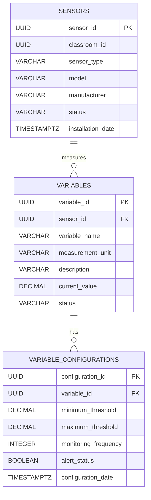

# Sensor Management Service — Data Model

## 1. Service

**Service Name:** Sensor Management Service
**Domain:** Sensor Management
**Database Engine:** PostgreSQL 15

The Sensor Management Service is responsible for managing environmental sensors, the variables measured by those sensors, and the configuration required to monitor those variables.

The service manages sensor metadata, sensor status, monitored variables, measurement units, thresholds, monitoring frequency, and alert configuration.

Classroom information does not belong to this service. The `classroom_id` field is a cross-domain reference to the Classroom Management Service.

---

# 2. Database Engine

## 2.1 Selected Database Engine

**PostgreSQL 15**

## 2.2 Engine Justification

PostgreSQL 15 was selected because the Sensor Management Service requires:

* Strong relational integrity.
* UUID support.
* Accurate decimal values for environmental measurements.
* Timestamp support for installation and configuration dates.
* Foreign key constraints between sensors, variables, and configurations.
* Reliable transactions.
* Flexible indexing capabilities.
* Compatibility with Java and Spring Boot.
* Compatibility with containerized and microservice-based deployments.

PostgreSQL also provides a reliable foundation for storing sensor metadata and environmental monitoring configurations.

---

# 3. PostgreSQL Configuration

The database uses PostgreSQL's `pgcrypto` extension to generate UUID values.

```sql
CREATE EXTENSION IF NOT EXISTS pgcrypto;
```

UUID values can then be generated using:

```sql
gen_random_uuid()
```

---

# 4. Database Naming Convention

All database identifiers use English and `snake_case`.

## Tables

```text
sensors
variables
variable_configurations
```

## Primary Keys

```text
sensor_id
variable_id
configuration_id
```

## Foreign Keys

```text
classroom_id
sensor_id
variable_id
```

## Timestamp Fields

```text
installation_date
configuration_date
```

---

# 5. Database Tables

The Sensor Management Service contains three tables:

1. `sensors`
2. `variables`
3. `variable_configurations`

The model is intentionally small because the service focuses on sensor and variable management rather than storing classroom or user information.

---

# 6. Table: sensors

## Purpose

Stores information about physical environmental sensors installed in monitored classrooms.

A sensor represents a physical device capable of measuring one or more environmental variables.

Examples include sensors that measure:

* Temperature
* Humidity
* CO2
* Noise

## SQL

```sql
CREATE TABLE sensors (
    sensor_id UUID PRIMARY KEY DEFAULT gen_random_uuid(),
    classroom_id UUID NOT NULL,
    sensor_type VARCHAR(100),
    model VARCHAR(100),
    manufacturer VARCHAR(100),
    status VARCHAR(50),
    installation_date TIMESTAMPTZ
);
```

## Indexes

```sql
CREATE INDEX idx_sensors_classroom_id
    ON sensors(classroom_id);

CREATE INDEX idx_sensors_status
    ON sensors(status);

CREATE INDEX idx_sensors_sensor_type
    ON sensors(sensor_type);
```

## Data Dictionary

| Column              | Type         | Constraints | Description                                                |
| ------------------- | ------------ | ----------- | ---------------------------------------------------------- |
| `sensor_id`         | UUID         | PK          | Unique identifier of the sensor.                           |
| `classroom_id`      | UUID         | NOT NULL    | Identifier of the classroom where the sensor is installed. |
| `sensor_type`       | VARCHAR(100) | NULL        | Type of sensor.                                            |
| `model`             | VARCHAR(100) | NULL        | Sensor model.                                              |
| `manufacturer`      | VARCHAR(100) | NULL        | Sensor manufacturer.                                       |
| `status`            | VARCHAR(50)  | NULL        | Current operational status of the sensor.                  |
| `installation_date` | TIMESTAMPTZ  | NULL        | Date and time when the sensor was installed.               |

## Modeling Decisions

`classroom_id` is intentionally not defined as a foreign key because the classroom entity belongs to another domain.

The Sensor Management Service should not directly access the Classroom Management database.

The reference is maintained at the application and integration level.

---

# 7. Table: variables

## Purpose

Stores the environmental variables measured by sensors.

A sensor can measure one or more variables.

Examples include:

```text
Temperature
Humidity
CO2
Noise
```

## SQL

```sql
CREATE TABLE variables (
    variable_id UUID PRIMARY KEY DEFAULT gen_random_uuid(),
    sensor_id UUID NOT NULL,
    variable_name VARCHAR(100),
    measurement_unit VARCHAR(50),
    description VARCHAR(255),
    current_value DECIMAL,
    status VARCHAR(50),

    CONSTRAINT fk_variables_sensor
        FOREIGN KEY (sensor_id)
        REFERENCES sensors(sensor_id)
        ON DELETE CASCADE
);
```

## Indexes

```sql
CREATE INDEX idx_variables_sensor_id
    ON variables(sensor_id);

CREATE INDEX idx_variables_status
    ON variables(status);

CREATE INDEX idx_variables_variable_name
    ON variables(variable_name);
```

## Data Dictionary

| Column             | Type         | Constraints  | Description                                    |
| ------------------ | ------------ | ------------ | ---------------------------------------------- |
| `variable_id`      | UUID         | PK           | Unique identifier of the monitored variable.   |
| `sensor_id`        | UUID         | NOT NULL, FK | Sensor responsible for measuring the variable. |
| `variable_name`    | VARCHAR(100) | NULL         | Name of the environmental variable.            |
| `measurement_unit` | VARCHAR(50)  | NULL         | Unit used to represent the measurement.        |
| `description`      | VARCHAR(255) | NULL         | Description of the variable.                   |
| `current_value`    | DECIMAL      | NULL         | Most recently recorded value.                  |
| `status`           | VARCHAR(50)  | NULL         | Current monitoring status of the variable.     |

## Modeling Decisions

Variables are separated from sensors because a single sensor can measure multiple environmental variables.

For example:

```text
Sensor A
 ├── Temperature
 ├── Humidity
 └── CO2
```

This avoids duplicating sensor information for every measurement variable.

---

# 8. Table: variable_configurations

## Purpose

Stores monitoring configuration parameters for each environmental variable.

These configurations define the acceptable measurement range, monitoring frequency, and alert state.

## SQL

```sql
CREATE TABLE variable_configurations (
    configuration_id UUID PRIMARY KEY DEFAULT gen_random_uuid(),
    variable_id UUID NOT NULL,
    minimum_threshold DECIMAL,
    maximum_threshold DECIMAL,
    monitoring_frequency INTEGER,
    alert_status BOOLEAN,
    configuration_date TIMESTAMPTZ,

    CONSTRAINT fk_variable_configurations_variable
        FOREIGN KEY (variable_id)
        REFERENCES variables(variable_id)
        ON DELETE CASCADE,

    CONSTRAINT chk_variable_configurations_thresholds
        CHECK (
            minimum_threshold IS NULL
            OR maximum_threshold IS NULL
            OR minimum_threshold <= maximum_threshold
        ),

    CONSTRAINT chk_variable_configurations_frequency
        CHECK (
            monitoring_frequency IS NULL
            OR monitoring_frequency > 0
        )
);
```

## Indexes

```sql
CREATE INDEX idx_variable_configurations_variable_id
    ON variable_configurations(variable_id);

CREATE INDEX idx_variable_configurations_alert_status
    ON variable_configurations(alert_status);
```

## Data Dictionary

| Column                 | Type        | Constraints  | Description                                                  |
| ---------------------- | ----------- | ------------ | ------------------------------------------------------------ |
| `configuration_id`     | UUID        | PK           | Unique configuration identifier.                             |
| `variable_id`          | UUID        | NOT NULL, FK | Variable associated with the configuration.                  |
| `minimum_threshold`    | DECIMAL     | NULL         | Minimum acceptable measurement value.                        |
| `maximum_threshold`    | DECIMAL     | NULL         | Maximum acceptable measurement value.                        |
| `monitoring_frequency` | INTEGER     | NULL         | Frequency at which the variable should be monitored.         |
| `alert_status`         | BOOLEAN     | NULL         | Indicates whether alert monitoring is enabled.               |
| `configuration_date`   | TIMESTAMPTZ | NULL         | Date and time when the configuration was created or updated. |

## Modeling Decisions

Configuration is separated from the variable entity because monitoring rules can change independently from the identity of the variable.

The threshold fields use `DECIMAL` because environmental measurements can contain fractional values.

For example:

```text
Temperature: 18.5 °C
Humidity: 62.7 %
CO2: 850.5 ppm
Noise: 48.3 dB
```

---

# 9. Relationship Model

The database contains two internal relationships.

### Sensor → Variable

One sensor can measure multiple variables.

```text
sensors 1 ─────── N variables
```

### Variable → Variable Configuration

One variable can have multiple configuration records.

```text
variables 1 ─────── N variable_configurations
```

The second relationship allows configuration history to be maintained if the application creates a new configuration record whenever monitoring parameters change.

---

# 10. Relationship Diagram



---

# 11. Cross-Domain Reference

The Sensor Management Service references classrooms using:

```text
sensors.classroom_id
```

The classroom entity belongs to the **Classroom Management Service**.

The relationship is conceptually:

```text
Sensor Management Service
        |
        | classroom_id
        v
Classroom Management Service
        |
        v
Classroom
```

There should be no direct database foreign key between the two services.

Each microservice owns its own database and its own domain entities.

---

# 12. Cross-Domain Data Ownership

The following ownership model is recommended:

| Data                   | Owner                        |
| ---------------------- | ---------------------------- |
| Sensor                 | Sensor Management Service    |
| Environmental Variable | Sensor Management Service    |
| Variable Configuration | Sensor Management Service    |
| Classroom              | Classroom Management Service |
| User                   | IAM Service                  |
| Role                   | IAM Service                  |
| Permission             | IAM Service                  |
| Authentication Session | IAM Service                  |

The Sensor Management Service only stores the identifier of the classroom.

It does not duplicate classroom information such as:

```text
classroom_name
building
floor
capacity
location
```

Those attributes belong to the Classroom Management Service.

---

# 13. Sensor Status

The `status` field represents the operational state of a sensor.

Possible application-level values include:

```text
ACTIVE
INACTIVE
MAINTENANCE
OFFLINE
ERROR
```

The exact status catalog can later be normalized into a dedicated `sensor_statuses` table if the domain requires more complex lifecycle management.

For the current scope, keeping the field as `VARCHAR(50)` maintains a simple model.

---

# 14. Variable Status

The `status` field represents the monitoring state of an environmental variable.

Possible values include:

```text
ACTIVE
INACTIVE
WARNING
CRITICAL
UNAVAILABLE
```

These values can later be converted into a dedicated status table or PostgreSQL enum if stronger domain-level restrictions are required.

---

# 15. Threshold Management

The `minimum_threshold` and `maximum_threshold` fields define the expected measurement range.

Conceptually:

```text
                 Acceptable Range
                       |
                       v
       minimum_threshold <= value <= maximum_threshold
```

If a measurement falls outside the configured range, the application can evaluate whether an alert should be generated.

The database does not automatically generate alerts.

Alert generation belongs to the application's domain logic or an eventual monitoring/alerting service.

---

# 16. Monitoring Frequency

The `monitoring_frequency` field defines how frequently a variable should be monitored.

The application should establish a standard unit for this value.

For example:

```text
monitoring_frequency = 60
```

could represent 60 seconds if the system defines the field in seconds.

The unit should be documented consistently in the API and application layer.

---

# 17. Current Value

The `current_value` field stores the latest known value of the environmental variable.

It is not intended to replace a historical measurement database.

For example:

```text
Temperature → 24.5
Humidity    → 61.2
CO2         → 735.0
Noise       → 43.8
```

If the system later requires historical analysis, a separate measurement or telemetry domain should be considered.

---

# 18. Historical Measurements

The current Sensor Management database does **not** store historical measurements.

This is intentional.

The responsibility of this service is:

```text
Sensor Management
├── Sensor metadata
├── Environmental variables
└── Monitoring configuration
```

Historical telemetry could belong to a future:

```text
Telemetry Service
```

or:

```text
Environmental Monitoring Service
```

depending on the final architecture.

This separation prevents the Sensor Management database from becoming overloaded with high-volume time-series data.

---

# 19. Migration Strategy

## 19.1 Migration Tool

**Recommended Tool: Flyway**

Flyway provides:

* Version-controlled migrations.
* SQL-based schema management.
* Spring Boot integration.
* Migration history.
* CI/CD compatibility.
* Repeatable deployment processes.

## 19.2 Migration Naming Convention

```text
V<version>__<description>.sql
```

Examples:

```text
V1__create_sensors.sql
V2__create_variables.sql
V3__create_variable_configurations.sql
```

## 19.3 Migration Rules

Each migration must:

1. Have a unique version.
2. Use an English description.
3. Be committed to version control.
4. Never modify an already executed migration.
5. Preserve referential integrity.
6. Be tested before deployment.
7. Include required constraints and indexes.
8. Be compatible with the corresponding application version.

---

# 20. Recommended Migration Order

The tables should be created in dependency order:

```text
1. sensors
2. variables
3. variable_configurations
```

This order is required because:

```text
variables
    ↓
sensors
```

and:

```text
variable_configurations
    ↓
variables
```

must exist before their foreign keys are created.

---

# 21. Compatible Schema Changes

Generally compatible changes include:

* Adding a new nullable column.
* Adding a new table.
* Adding an index.
* Increasing a VARCHAR length.
* Adding optional metadata.
* Adding a new sensor status.
* Adding a new variable status.

All changes should still be tested against the running application.

---

# 22. Incompatible Schema Changes

Potentially incompatible changes include:

* Removing a column.
* Renaming a column.
* Renaming a table.
* Changing a column type.
* Removing a foreign key.
* Changing the meaning of an existing field.
* Making a nullable column `NOT NULL`.
* Removing existing sensor records.
* Changing the unit or meaning of `monitoring_frequency`.

Breaking changes should be coordinated between the database, application, and API versions.

---

# 23. Expand-and-Contract Strategy

For major schema changes, the service should use an expand-and-contract approach.

## Phase 1 — Expand

Add the new structure without removing the old structure.

## Phase 2 — Migrate

Update the application to support the new structure.

## Phase 3 — Backfill

Migrate existing data when necessary.

## Phase 4 — Switch

Change the application to use the new structure.

## Phase 5 — Contract

Remove the old structure after confirming that it is no longer used.

This reduces deployment risks in a distributed architecture.

---

# 24. UUID Strategy

All primary keys use PostgreSQL UUID values.

Example:

```sql
sensor_id UUID PRIMARY KEY DEFAULT gen_random_uuid()
```

UUIDs provide:

* Globally unique identifiers.
* Better suitability for distributed architectures.
* Reduced predictability compared with sequential IDs.
* Independence from database sequences.
* Easier integration between independent services.

---

# 25. Timestamp Strategy

The service uses:

```sql
TIMESTAMPTZ
```

for timestamps.

Relevant fields include:

```text
installation_date
configuration_date
```

Using timezone-aware timestamps helps maintain consistent temporal information across distributed services and deployments.

---

# 26. Referential Integrity Strategy

Internal relationships use PostgreSQL foreign keys.

For example:

```text
variables.sensor_id
        ↓
sensors.sensor_id
```

and:

```text
variable_configurations.variable_id
        ↓
variables.variable_id
```

`ON DELETE CASCADE` is used for dependent records.

If a sensor is removed, its associated variables are removed.

If a variable is removed, its associated configurations are removed.

Cross-domain relationships do not use database-level foreign keys.

---

# 27. Indexing Strategy

Indexes are provided for fields commonly used for:

* Classroom filtering.
* Sensor status filtering.
* Sensor type filtering.
* Variable lookup.
* Variable status filtering.
* Configuration lookup.
* Alert-status filtering.

Main indexes:

```text
idx_sensors_classroom_id
idx_sensors_status
idx_sensors_sensor_type
idx_variables_sensor_id
idx_variables_status
idx_variables_variable_name
idx_variable_configurations_variable_id
idx_variable_configurations_alert_status
```

Index usage should be reviewed as query patterns evolve.

---

# 28. Security Considerations

The Sensor Management Service does not store authentication credentials.

Authentication and authorization are handled by the IAM Service.

Access to sensor management operations should be controlled through permissions provided by IAM.

Examples include:

```text
SENSOR_READ
SENSOR_CREATE
SENSOR_UPDATE
SENSOR_DELETE

VARIABLE_READ
VARIABLE_CREATE
VARIABLE_UPDATE
VARIABLE_DELETE

VARIABLE_CONFIGURATION_READ
VARIABLE_CONFIGURATION_CREATE
VARIABLE_CONFIGURATION_UPDATE
```

The exact permission model should be defined in the IAM Service.

---

# 29. Domain Boundaries

The Sensor Management Service owns:

```text
Sensor
Variable
Variable Configuration
```

It does not own:

```text
User
Role
Permission
Classroom
Historical Measurement
Alert
```

Those concepts should belong to their corresponding domains.

A possible architecture is:

```text
                    ┌─────────────────────┐
                    │    IAM Service      │
                    │ Users / Roles       │
                    │ Permissions         │
                    └──────────┬──────────┘
                               │
                               │ Authentication
                               │ Authorization
                               v
┌───────────────────┐   ┌─────────────────────┐
│ Classroom         │   │ Sensor Management   │
│ Management        │<--│ Service             │
│ Service           │   │                     │
│                   │   │ Sensors              │
│ Classrooms        │   │ Variables            │
│ Locations         │   │ Configurations       │
└───────────────────┘   └──────────┬──────────┘
                                   │
                                   │ Measurements
                                   v
                         ┌─────────────────────┐
                         │ Telemetry /         │
                         │ Monitoring Service  │
                         └─────────────────────┘
```

---

# 30. Correlation with API Documentation

The database supports API operations such as:

```text
GET    /sensors
GET    /sensors/{id}
POST   /sensors
PUT    /sensors/{id}
DELETE /sensors/{id}

GET    /sensors/{id}/variables
POST   /sensors/{id}/variables

GET    /variables/{id}
PUT    /variables/{id}

GET    /variables/{id}/configuration
POST   /variables/{id}/configuration
PUT    /variables/{id}/configuration
```

The exact endpoints may evolve according to the API design.

The API layer should expose DTOs rather than database entities directly.

---

# 31. Correlation with Domain Events

The Sensor Management Service may publish domain events when important changes occur.

Potential events include:

```text
SensorRegistered
SensorUpdated
SensorStatusChanged
VariableRegistered
VariableConfigurationUpdated
MonitoringThresholdChanged
```

These events can later be consumed by other services such as:

```text
Telemetry Service
Alert Service
Notification Service
Analytics Service
```

The messaging technology should be defined at the architecture level.

---

# 32. Correlation with the Overall System

The Sensor Management Service is one bounded context within the overall EduAirControl architecture.

Its main responsibility is to define:

```text
What sensors exist?
What variables does each sensor measure?
How should each variable be monitored?
What thresholds apply?
```

It should not be responsible for:

```text
Who is the user?
Which role does the user have?
Which classroom belongs to which institution?
What historical measurements have been collected?
Who should receive an alert?
```

Those responsibilities should remain within their corresponding domains.

---

# 33. Final Design Summary

The Sensor Management Service uses PostgreSQL 15 and contains three core tables:

```text
sensors
variables
variable_configurations
```

The model follows these principles:

* English-only database identifiers.
* `snake_case` naming convention.
* Plural table names.
* UUID primary keys.
* `TIMESTAMPTZ` timestamps.
* Explicit internal foreign keys.
* No cross-database foreign keys.
* Normalized sensor and variable information.
* Separate monitoring configuration.
* Decimal values for environmental measurements.
* Clear domain ownership.
* Version-controlled database migrations.
* Indexes based on expected query patterns.
* Separation between sensor metadata and historical telemetry.

The resulting bounded context is:

**Sensor Management Service**

with responsibility for **sensor registration, environmental variable management, and monitoring configuration**.
