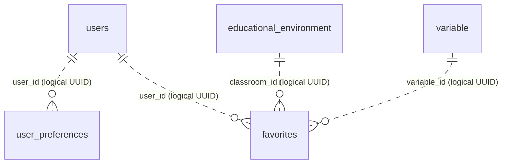

# User Experience Service — Active Data Model

> Scope follows the current backend implementation. Search history and classroom ratings have been retired. Their historical rows are retained as `legacy_searches` and `legacy_classroom_ratings` by Liquibase changeset `005-deprecate-ratings-and-search-history`; they are not active domain tables or API resources.

## Service boundary

`ms-user-experience` owns user preferences and favorites in PostgreSQL schema `user_experience`. It does not own users, environments, variables, or alerts; those are referenced by UUID and accessed through APIs/events or read projections. Liquibase is the schema migration tool.

## Active domain tables

### `user_preferences`

One preferences row per user.

| Column | Type | Nullable | Meaning |
|---|---|---:|---|
| `preference_id` | UUID | No | Primary key |
| `user_id` | UUID | No | Authenticated user; unique logical reference to `ms-security` |
| `language` | VARCHAR(10) | Yes | Interface language |
| `color_theme` | VARCHAR(20) | Yes | Color theme |
| `notifications_enabled` | BOOLEAN | No | Notification preference; defaults to true |
| `time_zone` | VARCHAR(100) | Yes | User's timezone |
| `date_format` | VARCHAR(20) | Yes | Preferred date format |
| `reminders` | JSONB | No | Reminder options; defaults to an empty object |
| `dark_mode` | BOOLEAN | No | Dark mode preference |
| `auto_time_zone` | BOOLEAN | No | Automatic timezone preference |

### `favorites`

Stores a user's saved environment or variable. At least one target ID must be present. `user_id`, `classroom_id` and `variable_id` are logical UUID references to their owning services. Writes are scoped to the current user and institution.

### `educational_environment`

Read projection containing `educational_environment_id`, code, name and `institution_id`. Classroom lifecycle events update it; it is used to check institution membership and is not authoritative classroom data.

### `inbox_message`

Technical idempotency ledger keyed by the source `message_id`, with consumer, message type and receipt timestamp.

### `notification_state` — migration staging only

Historical staging data for the UX backfill. The current service does not expose a notification-state API or actively manage this table. Alert ownership and alert lifecycle belong to `ms-environment-monitoring`.

## Retired data

| Legacy table | Former purpose | Current treatment |
|---|---|---|
| `legacy_searches` | Persisted a user's search text and filters | Rows retained after table rename; no entity, repository, endpoint, or backfill remains active. |
| `legacy_classroom_ratings` | Persisted environment scores and comments | Rows retained after table rename; no entity, repository, endpoint, or backfill remains active. |

The initial migration files still mention the former table names because executed Liquibase changesets must remain immutable. A later changeset renames both tables and removes their dedicated indexes. Its rollback restores the previous names and indexes.

## Relationships

The dotted relationships cross service ownership boundaries and are not SQL foreign keys. The local `educational_environment` projection is updated by classroom events. The inbox and notification staging table are technical/migration data rather than part of the active preference/favorite relationship model.

## Runtime API

The active API supports reading/updating preferences and listing/toggling/removing favorites. There are no active search-history or rating endpoints. See the service's [OpenAPI contract](../../07-api/contracts/openapi/ms-user-experience.yaml) and [microservice guide](../../09-microservices/services/07-ms-user-experience/README.md).
