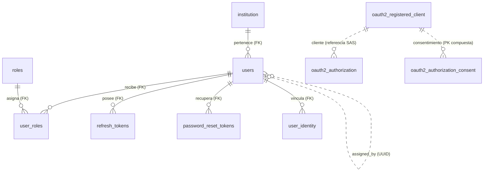
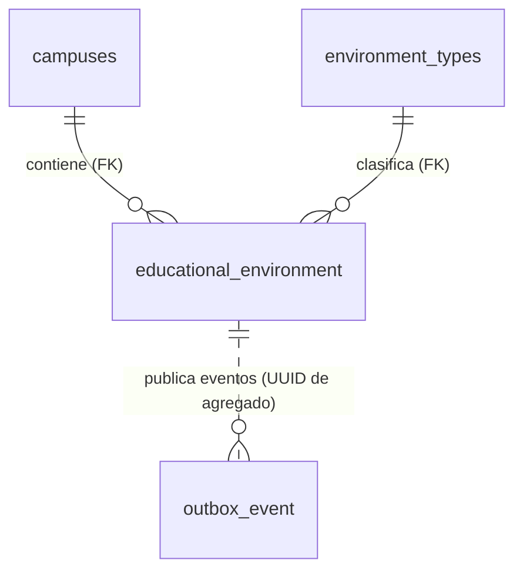
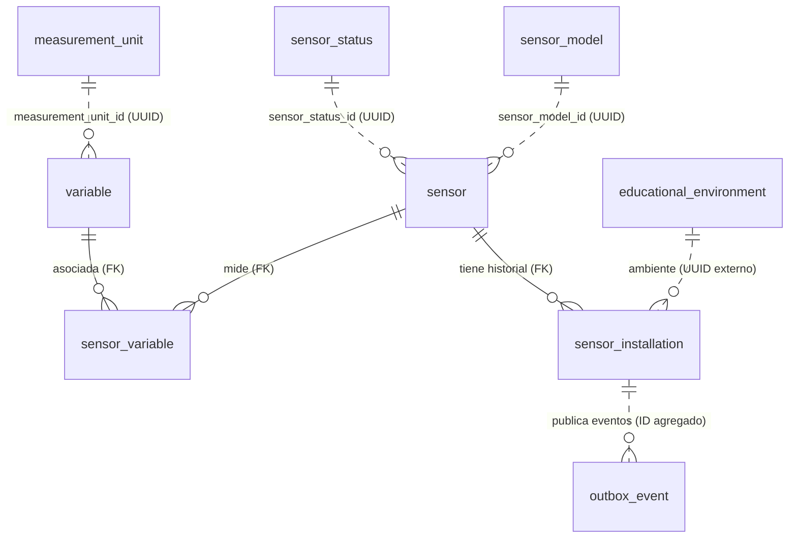
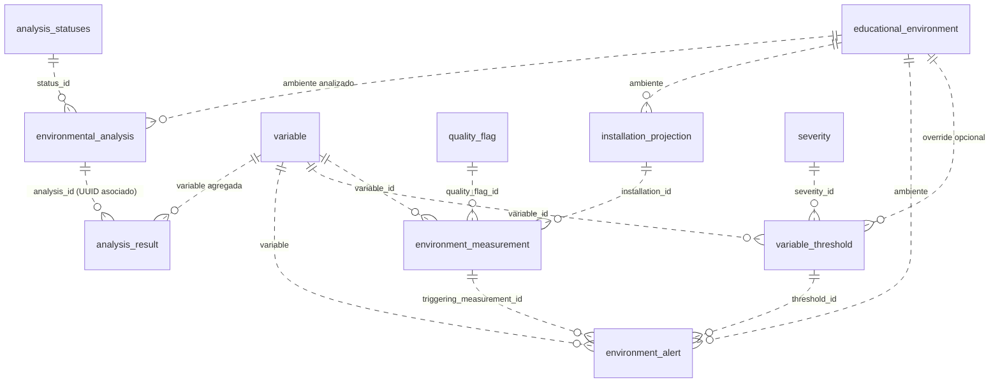
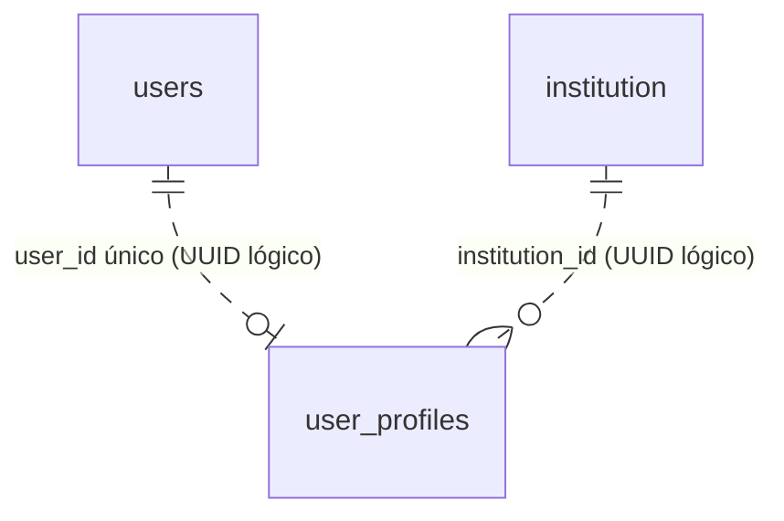
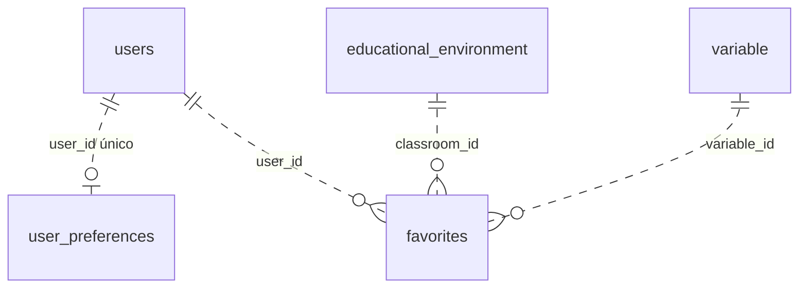
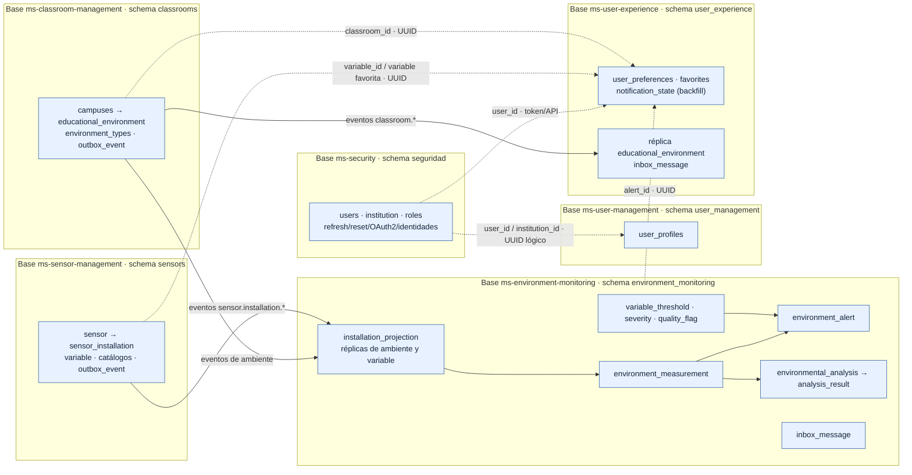

# Guía detallada de la base de datos de EduAirControl

> Inventario de la implementación vigente. Las migraciones Liquibase de cada microservicio son la fuente para conocer las tablas que se crean; los modelos de `06-data/domain/` describen la intención canónica y pueden ir detrás de cambios ya desplegados.

## 1. Cómo está organizada

EduAirControl usa PostgreSQL y separa la propiedad de los datos por microservicio. El sistema tiene seis esquemas funcionales. En despliegues locales cada servicio puede usar su propia base de datos; aunque varios esquemas terminen en la misma instancia PostgreSQL, eso no convierte sus tablas en datos compartidos: cada servicio es el único propietario de su esquema.

| Servicio | Esquema | Base local documentada | Responsabilidad |
|---|---|---|---|
| `ms-security` | `seguridad` | `eduaircontrol_security` | Credenciales, identidad, roles, sesiones y OAuth2 |
| `ms-classroom-management` | `classrooms` | `eduaircontrol_classrooms` | Instituciones reflejadas, sedes, tipos y ambientes educativos |
| `ms-sensor-management` | `sensors` | `eduaircontrol_sensors` | Sensores, instalaciones, variables y catálogos físicos |
| `ms-environment-monitoring` | `environment_monitoring` | `eduaircontrol_monitoring` | Mediciones, umbrales, alertas, análisis y proyecciones de eventos |
| `ms-user-management` | `user_management` | `eduaircontrol_user_management` | Perfiles complementarios de usuario |
| `ms-user-experience` | `user_experience` | `eduaircontrol_user_experience` | Preferencias y favoritos; conserva dos tablas históricas renombradas como legacy |

El gateway no es propietario de datos de negocio. Redis, RabbitMQ y los registros internos de Liquibase tampoco forman parte de estas tablas de dominio.

## 2. Convenciones de lectura

- `UUID` es el identificador usado para entidades y para correlacionar mensajes entre servicios.
- `TIMESTAMPTZ` guarda fecha y hora con zona/instante; `DATE` solo una fecha.
- `PK` identifica una fila. `FK` es una restricción real dentro del mismo esquema.
- Las referencias a otro servicio suelen ser UUID lógicos: no hay FK entre bases. El propietario valida y distribuye cambios mediante API/eventos.
- `deleted_at` representa borrado lógico cuando existe. `removed_at` en una instalación cierra el periodo histórico, no borra el registro.
- `outbox_event` conserva eventos pendientes/publicados junto con la transacción de negocio; `inbox_message` evita procesar dos veces el mismo mensaje.

## 3. Esquema `seguridad` — autenticación e identidad

Propietario: `ms-security`. Este servicio es la fuente autorizada de identidad y autenticación. La información de perfil (nombre, teléfono, etc.) está en `user_management`, no en las credenciales.

| Tabla | Clave / relaciones | Qué almacena |
|---|---|---|
| `institution` | PK `id`; `code` único | Instituciones/tenants, nombre, tipo, estado y marcas de creación/actualización. |
| `users` | PK `id`; `email` y `username` únicos; FK `institution_id` → `institution.id`; `campus_id` lógico hacia `classrooms` | Cuenta de acceso, hash de contraseña cuando aplica, verificación de correo, intentos fallidos, bloqueo temporal, institución/sede y borrado lógico. El acceso federado permite contraseña nula en la migración vigente. |
| `roles` | PK `id`; `name` único | Catálogo de roles, por ejemplo ADMIN, USER y VIEWER. |
| `user_roles` | PK compuesta (`user_id`, `role_id`); FKs a `users` y `roles` | Asignación N:M de roles, fecha y usuario que asignó. |
| `refresh_tokens` | PK `id`; FK `user_id` → `users.id` | Hash del refresh token, expiración, revocación, fecha y agente de usuario. No debe almacenar el token de refresco en claro. |
| `password_reset_tokens` | PK `id`; FK `user_id` → `users.id` | Hash del código de recuperación, vencimiento y momento de uso. |
| `user_identity` | PK `id`; FK `user_id` → `users.id`; único (`provider`, `provider_user_id`) y (`user_id`, `provider`) | Identidades de proveedores externos: proveedor, identificador, correo/nombre/avatar del proveedor. |
| `oauth2_registered_client` | PK textual `id` | Clientes registrados, métodos de autenticación, flujos, URI, scopes y configuración SAS. |
| `oauth2_authorization` | PK textual `id` | Autorizaciones y valores/metadatos/fechas de códigos y tokens OAuth2/OIDC. |
| `oauth2_authorization_consent` | PK compuesta (`registered_client_id`, `principal_name`) | Authorities/consentimiento asociado a cliente y principal. |

Los UUID `user_id` usados en otros esquemas apuntan a `seguridad.users.id` por valor. Redis guarda claves temporales de revocación/limitación de intentos, fuera de PostgreSQL.

### Diagrama del esquema `seguridad`



`campus_id` en `users` es un UUID lógico a `classrooms.campuses`; no forma parte de este ER como FK.

## 4. Esquema `classrooms` — sedes y ambientes

Propietario: `ms-classroom-management`.

| Tabla | Clave / relaciones | Qué almacena |
|---|---|---|
| `campuses` | PK `campus_id`; `code` único | Sedes, nombre, ciudad, estado y marcas de auditoría/borrado lógico. Las migraciones actuales agregan `institution_id` UUID para el tenant, validado lógicamente contra `seguridad`. |
| `environment_types` | PK `environment_type_id`; `code` y `name` únicos | Tipos de espacios (aula, laboratorio, biblioteca, etc.), descripción y borrado lógico. |
| `educational_environment` | PK `educational_environment_id`; FK `campus_id` → `campuses`; FK `environment_type_id` → `environment_types`; código único por sede | Espacio físico monitoreado, ubicación, piso, área, aforo, estado y fechas. Las migraciones agregan `institution_id` UUID lógico. |
| `outbox_event` | PK `event_id`; índices de pendientes y agregado | Eventos de ciclo de vida del ambiente: tipo, agregado, routing key, payload, ocurrencia, publicación, reintentos y último error. |

Hay checks para piso no negativo, área positiva y aforo positivo. Las FKs solo conectan entidades del propio esquema; sensor/monitoring/UX reciben el ID del ambiente por API o evento.

### Diagrama del esquema `classrooms`



El vínculo de `outbox_event` es informativo: el agregado se guarda como tipo e ID, no mediante FK.

## 5. Esquema `sensors` — sensores y variables

Propietario: `ms-sensor-management`.

| Tabla | Clave / relaciones | Qué almacena |
|---|---|---|
| `sensor` | PK `sensor_id`; `serial_number` único; UUIDs a modelo/estado | Equipo registrado, número de serie, último contacto y auditoría. `sensor_model_id` y `sensor_status_id` tienen catálogos locales. |
| `sensor_installation` | PK `sensor_installation_id`; FK `sensor_id` → `sensor.sensor_id`; ambiente UUID lógico | Historial de instalación con inicio y `removed_at` nullable. La instalación abierta (`removed_at IS NULL`) es la vigente; cerrar conserva la historia. |
| `variable` | PK `variable_id`; `code` único; `measurement_unit_id` UUID | Magnitud medida (temperatura, humedad, CO₂ aproximado, ruido), nombre, unidad y descripción. |
| `sensor_variable` | PK compuesta (`sensor_id`, `variable_id`); FKs a `sensor` y `variable` | Asociación N:M entre sensores y variables que miden. |
| `sensor_model` | PK `sensor_model_id`; `code` único | Catálogo de modelos de hardware. |
| `sensor_status` | PK `sensor_status_id`; `code` único | Catálogo de estados posibles del sensor. |
| `measurement_unit` | PK `measurement_unit_id`; `code` único | Catálogo de unidades y símbolos. |
| `outbox_event` | PK `event_id`; índices de pendientes y agregado | Eventos de instalación/retiro para sincronizar proyecciones de monitoring. |

Las instalaciones no se eliminan físicamente. El ambiente es una referencia lógica al esquema `classrooms`. El servicio impide eliminar un sensor que tenga historial de instalación.

### Diagrama del esquema `sensors`



Los UUID de modelo/estado/unidad se validan contra catálogos en el mismo servicio, pero las migraciones actuales no declaran FKs para ellos. `educational_environment` es una entidad de otro esquema y solo se referencia por UUID.

## 6. Esquema `environment_monitoring` — mediciones, análisis y alertas

Propietario: `ms-environment-monitoring`. También contiene réplicas de lectura de datos que pertenecen a classrooms y sensors.

| Tabla | Clave / relaciones | Qué almacena |
|---|---|---|
| `environment_measurement` | PK `environment_measurement_id`; único (`sensor_installation_id`, `variable_id`, `measured_at`) | Una lectura por instalación, variable e instante: valor decimal, instante de medición, calidad y creación. Instalación y variable son referencias UUID lógicas. |
| `installation_projection` | PK `sensor_installation_id` | Proyección local instalación → ambiente/sensor, fecha de retiro y sincronización. Se alimenta con eventos de sensors y permite resolver consultas sin pedir al otro servicio cada vez. |
| `variable` | PK `variable_id`; `code` único | Réplica de lectura del catálogo de variables; incluye símbolo de unidad para mostrar lecturas. |
| `educational_environment` | PK `educational_environment_id` | Réplica de lectura del ambiente: código, nombre, sede, tipo, piso e `institution_id`. La alimentan eventos de classrooms. |
| `variable_threshold` | PK `variable_threshold_id`; índice único parcial/lógico por ambiente + variable + severidad | Límites mínimo/máximo, severidad, intervalo de vigencia y, opcionalmente, ambiente específico. Puede configurarse por tipo de ambiente y sobreescribirse por espacio. No se debe sobrescribir historia: se cierra con `valid_to`. |
| `severity` | PK `severity_id`; `code` y `level` únicos | Catálogo de severidad (INFO, WARNING, CRITICAL). |
| `quality_flag` | PK `quality_flag_id`; `code` único | Clasificación de calidad de medición (VALID, SUSPECT, BAD). |
| `environment_alert` | PK `environment_alert_id`; referencias lógicas a ambiente, variable, umbral y medición | Alerta trazable: momento de generación, código de severidad, datos de reconocimiento (`acknowledged_at/by`) y borrado lógico (`deleted_at`). |
| `analysis_statuses` | PK `analysis_status_id`; `code` único | Estados del análisis: PENDING, RUNNING, COMPLETED, FAILED. |
| `environmental_analysis` | PK `environmental_analysis_id`; UUID `analysis_status_id` relacionado con el catálogo por la aplicación | Solicitud/resultado de análisis para un ambiente y ventana temporal `[period_start, period_end)`, solicitante lógico y fecha de cálculo. Check exige inicio anterior al fin. |
| `analysis_result` | PK `analysis_result_id`; único (`environmental_analysis_id`, `variable_id`) | Agregados por variable: mínimo, máximo, promedio, cantidad de muestras y cantidad que excede el umbral. `environmental_analysis_id` identifica al análisis asociado. |
| `inbox_message` | PK `message_id` | Mensajes del broker ya procesados, consumidor, tipo y recepción; permite idempotencia. |

Las lecturas son datos atómicos; no guardan una fila “ancha” con varias variables. El índice compuesto sobre instalación/variable/instante y los índices temporales y por variable ayudan al volumen de consultas. Los análisis son derivados de las lecturas y no las sustituyen. Las migraciones SQL canónicas actuales definen las asociaciones de análisis, estado, severidad, umbral y medición mediante UUID/índices y lógica de aplicación; no crean FKs físicas para ellas.

### Diagrama del esquema `environment_monitoring`



Las líneas punteadas indican asociaciones por UUID, no constraints FK en el DDL actual. `installation_projection`, `variable` y `educational_environment` son datos locales replicados/proyectados desde `sensors` y `classrooms`.

## 7. Esquema `user_management` — perfil

Propietario: `ms-user-management`.

| Tabla | Clave / relaciones | Qué almacena |
|---|---|---|
| `user_profiles` | PK `profile_id`; `user_id` único; `institution_id` lógico | Perfil complementario: `full_name`, teléfono, departamento, cargo, locale, estado, fechas y borrado lógico. `avatar_url` es `TEXT` en la migración más reciente. `user_id` e institución se validan por UUID contra `ms-security`, sin FK cruzada. |

Un usuario tiene como máximo un perfil. El login/correo/contraseña pertenecen a `seguridad.users`; el perfil no duplica credenciales.

### Diagrama del esquema `user_management`



Ambos extremos (`users`, `institution`) pertenecen a `seguridad`; no son tablas de `user_management` ni FKs cruzadas.

## 8. Esquema `user_experience` — personalización

Propietario: `ms-user-experience`.

| Tabla | Clave / relaciones | Qué almacena |
|---|---|---|
| `user_preferences` | PK `preference_id`; `user_id` único | Idioma, tema, notificaciones, zona horaria, formato de fecha, recordatorios JSONB, modo oscuro y detección automática de zona horaria. |
| `favorites` | PK `favorite_id`; check: ambiente o variable debe estar definido | Favoritos de ambientes y/o variables por usuario. Los UUID son referencias lógicas a seguridad, classrooms y sensors. |
| `notification_state` | PK compuesta (`user_id`, `alert_id`) | Tabla de staging de backfill; no tiene API activa en `ms-user-experience`. |
| `educational_environment` | PK `educational_environment_id` | Réplica ambiente → institución para validar el tenant de favoritos. Se actualiza por eventos de classrooms. |
| `inbox_message` | PK `message_id` | Registro de eventos de ambientes procesados para idempotencia. |

Las escrituras de UX se limitan al usuario del token. Las réplicas no son autoridad para modificar el ambiente original. Search history y classroom ratings se retiraron del alcance activo; el frontend y otros servicios no los consumen.

Las filas existentes se conservan bajo `legacy_searches` y `legacy_classroom_ratings`, tras una migración reversible. No hay código runtime, endpoints, rutas de gateway ni backfill activos para estas tablas.

### Diagrama del esquema `user_experience`



Los enlaces a `users`, `educational_environment` y `variable` son referencias lógicas a otros servicios. `inbox_message` guarda IDs/tipos de mensajes para idempotencia y `notification_state` se conserva únicamente para backfill; ambos son datos técnicos, no relaciones activas del dominio.

## 9. Relaciones entre esquemas y flujo de datos



En el diagrama general, las flechas continuas representan propagación de eventos/proyecciones; las punteadas son referencias UUID usadas por API/datos de usuario. No representan FKs SQL entre bases. Dentro de cada esquema, los diagramas de arriba indican las FKs reales cuando existen; las asociaciones lógicas se dibujan punteadas.

## 10. Qué hace cada microservicio con su base

Esta vista resume la responsabilidad en ejecución observada en el backend, no solo lo que sugiere el nombre de una tabla.

| Microservicio | Datos que administra/consulta en su esquema | Uso en la aplicación backend |
|---|---|---|
| `ms-security` | `users`, `institution`, roles, sesiones/tokens, recuperación e identidades OAuth2/sociales | Registro/autenticación, roles, tokens/JWKS, aislamiento por institución y recuperación de contraseña. Los otros servicios validan JWT y obtienen identidad/tenant del token. |
| `ms-classroom-management` | Sedes, tipos y ambientes educativos, outbox de eventos | CRUD de catálogo/ambientes; genera eventos para que otros servicios mantengan proyecciones locales. |
| `ms-sensor-management` | Sensores, instalaciones, variables, modelos/estados/unidades, outbox | CRUD de sensores/catálogos y apertura/cierre de instalaciones; publica eventos de instalación consumidos por monitoring. |
| `ms-environment-monitoring` | Mediciones, umbrales, alertas, análisis, réplicas e inbox | Ingesta de mediciones, evaluación de umbrales, lectura de dashboard, alertas y análisis históricos. Consume eventos de classrooms/sensors para poblar proyecciones. |
| `ms-user-management` | Perfiles e institución lógica | CRUD/consulta de datos de perfil separado de las credenciales de autenticación. |
| `ms-user-experience` | Preferencias, favoritos y proyecciones de ambientes | Mantiene preferencias y favoritos por usuario. Search history y ratings se retiraron; sus filas se conservan en tablas legacy sin API activa. |

La guía se refiere al código presente en el workspace. Para conocer qué rutas consume actualmente el frontend, hay que contrastar además cada aplicación cliente; que un endpoint exista no demuestra que la interfaz lo invoque.

## 11. Índices, restricciones y ciclo de vida

- Las claves únicas evitan duplicar correo/usuario, códigos de catálogos, seriales, variables por sensor, perfiles por usuario y resultados por variable/análisis.
- Los índices priorizan búsquedas por usuario, tenant, ambiente, variable, instante de medición, instalación y alertas recientes.
- Los límites de dominio se protegen con `CHECK` (aforo/área/piso, ventana de análisis y destino de favorito).
- El borrado lógico está presente en entidades con trazabilidad/perfiles; las instalaciones se cierran con fecha. La eliminación física depende de reglas de cada servicio.
- No se deben crear FKs que crucen esquemas de microservicios: se perdería la independencia de despliegue. Para corregir referencias cruzadas se consulta al servicio propietario o se actualizan proyecciones por eventos.

## 12. Migraciones y cómo consultar el estado real

Los servicios aplican Liquibase al iniciar y declaran `ddl-auto=none` o `validate`; no se recomienda modificar tablas manualmente como método de cambio. Cada servicio mantiene su changelog y sus tablas `DATABASECHANGELOG` / `DATABASECHANGELOGLOCK` en su propia base. Los changesets ya ejecutados son inmutables: agrega uno nuevo para cambiar el modelo.

Para inventariar un despliegue PostgreSQL, conectado a la base correspondiente:

```sql
-- Esquemas de dominio
SELECT schema_name
FROM information_schema.schemata
WHERE schema_name IN (
  'seguridad', 'classrooms', 'sensors',
  'environment_monitoring', 'user_management', 'user_experience'
)
ORDER BY schema_name;

-- Tablas y columnas de los esquemas
SELECT table_schema, table_name, ordinal_position, column_name,
       data_type, is_nullable, column_default
FROM information_schema.columns
WHERE table_schema IN (
  'seguridad', 'classrooms', 'sensors',
  'environment_monitoring', 'user_management', 'user_experience'
)
ORDER BY table_schema, table_name, ordinal_position;
```

Fuentes ejecutables principales: `ms-*/src/main/resources/db/changelog/`. En local, los puertos PostgreSQL por servicio están documentados en los `AGENTS.md` y `docker-compose.yml` respectivos.

## 13. Diferencias conocidas entre el modelo publicado y las migraciones

Estas diferencias significan que la guía toma como inventario la migración vigente:

1. Seguridad tiene `username`, `institution_id`, `campus_id` e identidades externas; `institution_id` es una FK local a `seguridad.institution`. El modelo de servicio antiguo no refleja por completo username/OAuth2/social identity.
2. `ms-sensor-management` implementa `sensor_model`, `sensor_status`, `measurement_unit` y `outbox_event`; esos catálogos existen en código aunque ciertos modelos canónicos los describan como referencias lógicas aún no materializadas.
3. Monitoring almacena `sensor_installation_id` y `quality_flag_id` en la medición, mantiene `installation_projection`, réplicas de catálogos, `inbox_message`, severidad de alerta, `deleted_at`, `institution_id` y override de umbral por ambiente. El antiguo `data-model.md` no enumera todos esos cambios.
4. La tabla de perfil real es `user_management.user_profiles`, con `profile_id`, `full_name`, departamento, cargo, locale e institución. No es `user_profile` ni los campos first/last name descritos en el modelo antiguo. El avatar está ampliado a `TEXT`.
5. La tabla actual de estado de notificación UX tiene PK (`user_id`, `alert_id`) y `read_at` obligatorio; no usa `notification_state_id`, `notification_id` o `acknowledged_at` como indica un modelo desfasado.
6. Las relaciones y detalles se deben confirmar con el changelog de la rama/versión desplegada. Una base existente puede tener changesets adicionales o datos distintos a una instalación nueva.

## Documentos relacionados

- [Modelos canónicos](./README.md)
- [Estrategia de base de datos (ADR-003)](../05-architecture/decisions/records/ADR-003-database-strategy.md)
- [Herramienta de migraciones (ADR-008)](../05-architecture/decisions/records/ADR-008-database-migration-tool.md)
- [Catálogo de servicios y puertos](../09-microservices/service-catalog.md)
