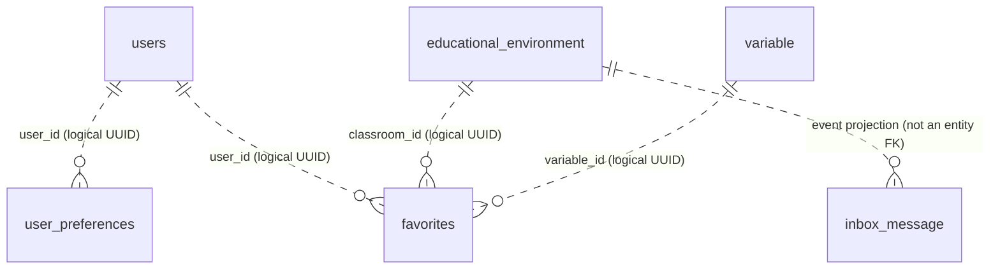

# Data Model — ms-user-experience

> This service actively owns user preferences and favorites. The Liquibase history retains renamed legacy tables for retired search history and ratings so existing data is not destroyed.

## Database

- Engine: PostgreSQL 15
- Schema: `user_experience`
- Migrations: Liquibase at `src/main/resources/db/changelog/`
- Cross-service IDs (`user_id`, `classroom_id`, `variable_id`, `institution_id`) are logical UUID references, not foreign keys.

## Active tables

| Table | Key and constraints | Purpose |
|---|---|---|
| `user_preferences` | PK `preference_id`; unique `user_id` | Language, theme, notification preference, timezone, date format, reminders and display options. |
| `favorites` | PK `favorite_id`; check requires `classroom_id` or `variable_id` | Environments and/or variables saved by a user. Writes are scoped to the authenticated user and institution. |
| `educational_environment` | PK `educational_environment_id` | Read projection of environment ID, code, name and institution, populated by classroom events for tenant checks. |
| `inbox_message` | PK `message_id` | Message IDs already processed by the classroom event consumer. |
| `notification_state` | Composite PK (`user_id`, `alert_id`) | Backfill-only migration staging table in the current implementation; it has no active notification API here. |

## Retired tables

Liquibase changeset `005-deprecate-ratings-and-search-history` renames the former tables:

| Retained table | Former table | Status |
|---|---|---|
| `legacy_searches` | `searches` | No active entity, repository, endpoint, or backfill. Rows retained for historical preservation. |
| `legacy_classroom_ratings` | `classroom_ratings` | No active entity, repository, endpoint, or backfill. Rows retained for historical preservation. |

The indexes dedicated to these legacy tables are removed to avoid ongoing index storage and write overhead. The rename changeset is reversible. Do not rename these tables back unless restoring the retired API and service code as a planned change.

## Relationships

`users` and `variable` belong to other services. `inbox_message` is a technical idempotency ledger; its connection to environment events is contextual rather than relational.

## API surface

The active API exposes preferences and favorites only. See the [OpenAPI contract](../../../07-api/contracts/openapi/ms-user-experience.yaml). Search history and ratings are absent from the runtime contract.
